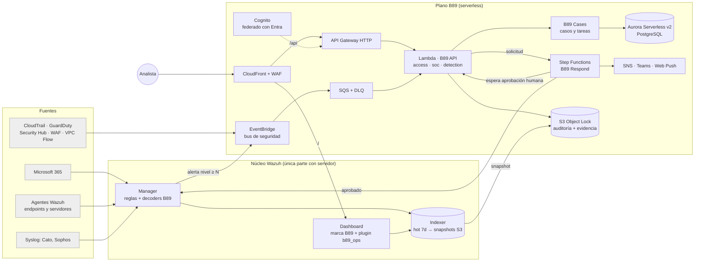

# 02 · Arquitectura

> Estado: **propuesto** salvo donde se indique. El código de `apps/`, `modules/` y `platform/` y el
> overlay `wazuh/` son **hechos**; el despliegue serverless descrito aquí aún no tiene Terraform en
> `infra/aws/` (ver [09](09-plan-de-lanzamiento.md)).

## En una frase

**B89 SOC es serverless en todo lo que puede serlo; lo único con servidor es el núcleo de
detección Wazuh, porque Wazuh no existe como servicio sin servidor.** Wazuh recolecta, detecta y
guarda; la capa B89 (API, casos, respuesta gobernada, auditoría, avisos) corre sobre Lambda, Step
Functions y servicios gestionados. Un login Entra protege todo.

## Principios de diseño (B89 es una fintech)

1. **Serverless por defecto.** Se paga por uso, no hay parches de SO ni capacidad ociosa. Se sale
   de la regla solo cuando el producto no existe sin servidor (Wazuh Manager/Indexer/Dashboard).
2. **Lo regulado es inmutable y separado.** Auditoría y evidencia en S3 Object Lock (modo
   compliance) y copia en una cuenta de seguridad aparte. Nadie, ni un administrador de la cuenta
   de carga, puede borrarlas.
3. **Costo predecible.** Sin NAT Gateway (endpoints de VPC), cómputo Graviton (arm64), HTTP API en
   vez de REST API, DynamoDB y Lambda bajo demanda, S3 con ciclo de vida a Glacier.
4. **Fallar cerrado.** Denegación por defecto, aprobación humana antes de toda acción de
   respuesta y efectos externos idempotentes.
5. **Un solo plano de acceso.** Cognito federado con Entra, MFA obligatorio y revocación inmediata.

## Diagrama

## Piezas y responsabilidades

| Pieza | Corre en | Responsabilidad | Código |
| --- | --- | --- | --- |
| CloudFront + WAF | Serverless | TLS, borde único (`/` y `/api`), reglas gestionadas y límite de tasa | `infra/aws` |
| Cognito | Serverless | Federación OIDC con Entra, MFA, sesiones y revocación | `modules/access` |
| B89 API | Lambda + API Gateway HTTP | Identidad, casos, correlación, SOAR gobernado, auditoría y avisos | `apps/api`, `modules/*`, `platform/*` |
| B89 Cases | Lambda + Aurora | Casos, tareas, evidencia y continuidad de investigación | `modules/soc` |
| B89 Respond | Step Functions (Standard) | Playbooks de respuesta con aprobación humana (`waitForTaskToken`) | `modules/soar`, `b89-respond/` |
| Ingesta cloud-native | EventBridge + SQS + Lambda | CloudTrail, GuardDuty, Security Hub y WAF normalizados a `SecurityEvent` | `modules/telemetry` |
| Colas y tareas | SQS + EventBridge Scheduler | Reemplazan BullMQ y el worker; reintentos y DLQ ([11](11-cache-y-colas.md)) | `apps/worker` |
| Estado operativo | Aurora Serverless v2 (PostgreSQL) | Casos, sesiones y cadena de auditoría; escala a cero ACU en inactividad | `platform/database` |
| Caché efímera | ElastiCache Serverless (Valkey) o DynamoDB TTL | Solo si la latencia lo exige; es opcional ([11](11-cache-y-colas.md)) | `platform/cache` |
| Auditoría y evidencia | S3 Object Lock + KMS | Inmutabilidad regulatoria; réplica a la cuenta de seguridad | `infra/aws` |
| Wazuh Manager + Indexer + Dashboard | **EC2 Graviton, un solo nodo** | Agentes, reglas, almacenamiento de alertas, ISM y UI de investigación | `wazuh/` |

## El núcleo Wazuh: por qué no es serverless y cómo se hace robusto

Wazuh Indexer y Dashboard **no funcionan sobre OpenSearch Serverless** (necesitan las APIs de
seguridad, ISM y plantillas del Indexer de Wazuh) y el Manager mantiene conexiones persistentes con
los agentes. Por eso es la única parte con servidor, y se reduce al mínimo:

- **Un nodo** EC2 arm64 en un Auto Scaling Group `min=max=1`, con la instancia reemplazada sola
  ante falla y el volumen de datos EBS cifrado con KMS.
- **Backups**: snapshots EBS diarios (Data Lifecycle Manager) y snapshots del Indexer a S3 (ISM).
  Es la fuente de verdad de recuperación, no el disco.
- **Sin NAT**: el nodo vive en subred privada con endpoints de VPC (S3, Secrets Manager, KMS,
  CloudWatch). Los agentes entran por un NLB.
- **Retención corta en caliente** (7 días) y el resto en S3, que es donde está el costo.
- **Crecimiento**: cuando el volumen exceda un nodo, el siguiente paso es un clúster de Indexer de
  tres nodos; no se anticipa.

Ese nodo es el punto de falla único aceptado en la demo. Su RTO objetivo (reemplazo automático más
restauración de snapshot) y su validación se definen en [06](06-operacion.md) y [09](09-plan-de-lanzamiento.md).

## Cuentas (AWS Organizations)

| Cuenta | Contenido |
| --- | --- |
| `b89-soc-workload` | Todo lo de la tabla de piezas |
| `b89-log-archive` | Réplica de auditoría y evidencia (Object Lock, solo escritura desde workload) |
| `b89-security-tooling` | GuardDuty, Security Hub y Detective como administrador delegado |

## Qué salió del diseño y por qué

| Retirado o sustituido | Motivo | Reemplazo |
| --- | --- | --- |
| **Frontend propio** (`apps/web`) | Duplicaba Discover y dashboards de Wazuh | UI de Wazuh con marca B89 y el plugin `b89_ops` ([08](08-frontend-unificado.md)) |
| **Shuffle en una VM** (SOAR) | Servidor adicional que operar y parchear | **B89 Respond** sobre Step Functions ([07](07-deteccion-ml-y-soar.md), [13](13-b89-respond.md)) |
| **ECS Fargate para la API** | Costo base fijo aun sin tráfico | Lambda + API Gateway HTTP |
| **RDS PostgreSQL fijo** | Pago continuo con baja carga | Aurora Serverless v2 con escala a cero |
| **Worker BullMQ** | Proceso persistente con Redis | SQS + EventBridge Scheduler |
| **KrakenD** | Sin salida genérica a proveedores; la lectura API → Indexer se hace por la ruta privada VPC | Lambda en VPC hacia el Indexer; retirar `platform/gateway` |
| **Perfil Azure** | B89 opera solo en AWS | Archivado en [`docs/archive/azure`](archive/azure/README.md) |
| **Grafana, Loki, Prometheus** | Su fin regulatorio lo cubre Wazuh | CloudWatch para infraestructura y Wazuh para seguridad |

## Arquitectura vital que se conserva

Esto es lo que da valor y no se toca sin una decisión en [10](10-decisiones.md):

1. **Monolito modular hexagonal.** `access`, `soc`, `detection`, `soar`, `connectors` y `telemetry`
   no importan frameworks. El empaquetado en Lambda es un adaptador en `apps/api`, no cambia el
   dominio; lo valida `pnpm boundaries`.
2. **Contrato canónico `SecurityEvent` 1.0.0** (`packages/contracts`). Wazuh y las fuentes AWS se
   normalizan a ese contrato antes de entrar al dominio.
3. **Mutación, auditoría y outbox en una sola transacción.** Si falla la auditoría, se revierte.
4. **Auditoría append-only verificable.** Cadena SHA-256 por tenant con un trigger que bloquea
   UPDATE/DELETE, más anclaje periódico del hash en S3 Object Lock.
5. **Denegación por defecto** con 25 capacidades × 4 roles × 3 scopes; las negaciones se auditan.
6. **Efectos externos idempotentes** con lease y fencing token; en Step Functions, con la
   ejecución nombrada por el identificador de la solicitud.
7. **Secretos solo por referencia** (`secretRef`) a Secrets Manager. Nunca en tfvars, estado,
   logs ni imágenes.

## Cómo se modifica el sistema de ahora en adelante

| Quiero… | Lo hago en… |
| --- | --- |
| Detectar algo nuevo | Una regla o decoder Wazuh en `wazuh/manager/rules/` con test de logtest |
| Una fuente nueva de AWS | Una regla de EventBridge y un normalizador en `modules/telemetry` |
| Una fuente nueva de endpoint o syslog | Un módulo Wazuh configurado en `wazuh/manager/` |
| Agrupar alertas en un caso o priorizarlas | TypeScript en `modules/detection` |
| Un flujo humano: estado, tarea o aprobación | TypeScript en `modules/soc` o `modules/soar` |
| Una acción de respuesta | Un playbook en `modules/soar` y su máquina de estados en B89 Respond, siempre con aprobación |
| Una vista nueva | El plugin `wazuh/dashboard/plugins/b89_ops` |
| Retención, ML o índices | JSON versionado en `wazuh/indexer/`, aplicado por script idempotente |
