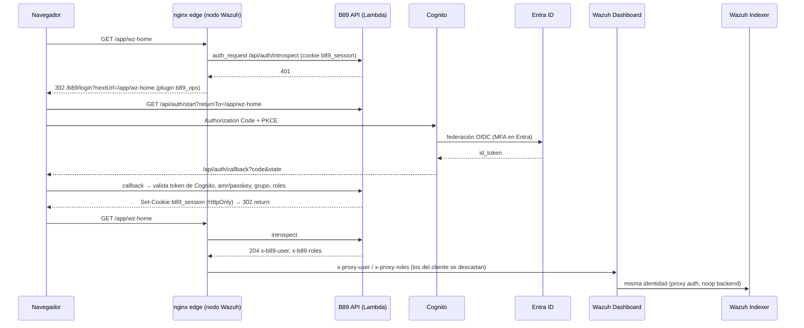

# 04 · Identidad y acceso

> Estado: la lógica de `modules/access` (OIDC PKCE, sesión, roles, Graph delta) es **hecha y
> probada con tests**, sin verificar contra Cognito ni AWS real. **Cognito federado con Entra, las
> Lambdas de identidad y el borde CloudFront son propuestos** ([02](02-arquitectura.md)). Los
> requisitos de la SBS (autenticación fuerte, separación de funciones, trazabilidad) se confirman
> con B89.

## Modelo

- **Entra ID decide quién es la persona y si puede entrar** (grupo SOC, app roles y MFA).
  **B89 decide qué puede hacer**: capacidades, scope, SoD y auditoría.
- **Cognito (user pool) es el único emisor de tokens de B89** y se federa con Entra por OIDC. La
  API B89 (Lambda) valida los tokens de Cognito y mantiene la sesión opaca. Las personas no
  tienen contraseña local en Cognito: se autentican en Entra.
- **Un solo login para todo.** El mismo login protege la consola de casos **y** el dashboard de
  Wazuh. No hay usuarios locales de Wazuh para personas. Los usuarios internos quedan solo para
  servicios (`b89_reader` y `wazuh-wui`) y para el break-glass.
- **MFA obligatorio, aplicado en Entra** (Conditional Access). La regla "passkey fuera de la red"
  vive en la API (`network.ts`) y exige que el claim `amr` de Entra llegue hasta ella a través de
  Cognito (mapeo de atributos o Lambda `pre-token-generation`): **por validar en la integración**.

## Excepción temporal de MFA/passkey de la demo anterior

`B89_DEMO_MFA_EXCEPTION_UNTIL` (en `apps/api/src/main.ts` y el esquema de configuración) permitía
completar el login sin prueba de MFA/passkey con vencimiento acotado. La fecha de la demo anterior
(2026-10-17) **ya venció**. En B89 SOC no se propaga: no se define la variable en ningún entorno
nuevo y se evalúa retirar el código en la fase 1 ([09](09-plan-de-lanzamiento.md)).

## Flujo

El tráfico entra por CloudFront + WAF: `/api` va a API Gateway HTTP (Lambda) y `/` al dashboard.
Con Lambda la API no tiene memoria entre invocaciones, por lo que **el estado del login (handshake
OIDC, lockout, CSRF) y la sesión van a Aurora y Secrets Manager**, no a memoria (ver Pendientes).

## Piezas

| Pieza | Estado | Archivo |
| --- | --- | --- |
| OIDC PKCE, `state`/`nonce`, validación RS256, `amr` y passkey fuera de la red | Hecho, 79 tests | `modules/access/src/{oidc-handshake,id-token,sign-in,network}.ts` |
| Sesión opaca (30 min de inactividad, 8 h absolutas, hash en Postgres) | Hecho (Postgres = Aurora, propuesto) | `modules/access/src/session.ts` |
| `GET /api/auth/introspect` → 204 con `x-b89-user` y `x-b89-roles` | Trabajo en curso **sin commitear en `main`** | `apps/api/src/soc/auth.controller.ts` |
| User pool de Cognito, proveedor OIDC de Entra y app client | Propuesto (sin Terraform aún) |
| nginx `auth_request` | Propuesto en esta rama | `wazuh/edge/b89-edge.conf` |
| Security plugin `proxy` (Indexer y Dashboard) | Propuesto en esta rama | `wazuh/indexer/security/`, `wazuh/dashboard/opensearch_dashboards.b89.yml` |
| Revocación al salir del grupo (Graph delta) | Hecho. Se ejecuta con EventBridge Scheduler + Lambda y además llama a `AdminUserGlobalSignOut` de Cognito (propuesto) | `apps/api/src/runtime/directory-sync.ts` |

## Acceso con usuario y contraseña

La pantalla de acceso (`/b89/login`, plugin `b89_ops`) ofrece dos entradas: **Continuar con
Microsoft Entra** y un formulario de **usuario y contraseña** (`b89_ops.login.passwordEnabled`).
El formulario envía `POST /api/auth/password` y, tras comprobar la credencial, entra por el mismo
`completeSignIn` que Entra. No es un camino paralelo: límite de tasa, Smart Lockout por (cuenta,
origen), política de red, roles, sesión única y auditoría son idénticos.

| Aspecto | Comportamiento |
| --- | --- |
| MFA | Se aplica la política vigente: dentro de la red basta MFA y **fuera se exige passkey**. Una contraseña sola no la cumple, así que fuera de la red este acceso se rechaza con `PASSKEY_REQUIRED` |
| No enumeración | Contraseña errónea, usuario inexistente y cuenta bloqueada devuelven el mismo `AUTH_FAILED` |
| Login CSRF | Se rechazan peticiones con `Sec-Fetch-Site: cross-site` o `Origin` ajeno |
| Credenciales | La página no las guarda; el formulario las envía directo a la API por POST, nunca por URL |
| Sin JavaScript | Funciona (formulario HTML estándar); el JS solo añade mostrar/ocultar contraseña y estados de carga |

Estado:

- **Hecho y verificado (pruebas, no AWS):** el flujo con el emisor local de desarrollo
  (`apps/api/test/bff.spec.ts`, 8 casos). Las personas sintéticas usan `LOCAL_DEV_PASSWORD`, que
  solo existe fuera del perfil de producción.
- **Propuesto, no implementado:** el verificador de producción. Con identidad de producción no hay
  verificador configurado y el endpoint rechaza todo con `AUTH_FAILED`, por lo que conviene
  **`b89_ops.login.passwordEnabled: false`** hasta tenerlo. La opción prevista es Cognito (usuarios
  nativos con MFA obligatorio) detrás del mismo puerto, lo que exige además un segundo paso de
  código MFA en la pantalla y que Cognito emita `amr`. Alta de usuarios, política de contraseñas y
  recuperación quedan por diseñar.
- **Excepción temporal de la demo:** una única cuenta administrativa sintética puede entrar por
  este formulario mientras esté vigente; ver la sección siguiente.

## Excepción demo: contraseña del administrador

Excepción **temporal y consciente** a la política (MFA dentro de la red, passkey fuera), pedida por
el dueño solo para la demo ([N13](10-decisiones.md)). Una única cuenta administrativa sintética
entra por el formulario de usuario y contraseña (`POST /api/auth/password`). Código:
`apps/api/src/access/demo-admin-credentials.ts`, `secops-runtime.ts` (`passwordSignIn`,
`completeSignInWith`, `resolveActor`) y `platform/configuration/src/schema/demo-admin-login.schema.ts`.
Pruebas: `apps/api/test/demo-admin-login.spec.ts`.

### Activación (apagada por defecto)

| Variable | Contenido |
| --- | --- |
| `B89_DEMO_ADMIN_LOGIN_ENABLED` | `true` para activarla; ausente o `false` = no existe |
| `B89_DEMO_ADMIN_LOGIN_UNTIL` | Vencimiento obligatorio, ISO 8601 UTC (`…Z`), como máximo 30 días desde el arranque |
| `B89_DEMO_ADMIN_USERNAME` | Usuario en minúsculas (`[a-z0-9._@+-]`, 3–64) |
| `B89_DEMO_ADMIN_PASSWORD_HASH` | Hash scrypt; en AWS como secreto de ECS (`api_extra_secrets` → Secrets Manager). En Azure, `B89_DEMO_ADMIN_PASSWORD_HASH_REF` (Key Vault) |

El hash se genera con `node scripts/dev/hash-demo-admin-password.mjs` (pide la contraseña dos
veces sin eco, o la lee por stdin; exige ≥ 14 caracteres e imprime solo el hash
`$scrypt$ln=16,r=8,p=1$<sal>$<clave>`). La contraseña en claro nunca va a variables, tfvars, logs
ni respuestas.

El arranque **falla** con `ConfigurationError` si: la bandera tiene otro valor, falta o está mal
formado el vencimiento, vence a más de 30 días, falta el usuario o el hash, el hash no es scrypt o
sus parámetros son débiles (N < 2^15, r < 8, sal < 16 bytes, clave < 32 bytes) o el perfil no la
admite. Al arrancar con la excepción activa, el log emite
`auth.demo_admin_password.active` con «excepción demo de contraseña ACTIVA hasta …».

**Perfil.** `development` y `test` la admiten. **La demo de AWS corre con `B89_PROFILE=production`**
(`infra/aws/modules/runtime/main.tf`); el código solo tiene tres perfiles. Por eso, en
`production` la excepción se admite **solo** si la identidad configurada es exactamente la del
despliegue demo (tenant, client y redirect de `infra/aws/environments/demo.tfvars`, la misma
atadura que la antigua excepción de MFA). Cualquier otro despliegue de producción no arranca
(`CONFIG_VALUE_INVALID` en `B89_DEMO_ADMIN_LOGIN_ENABLED`, `reason: DEMO_ADMIN_LOGIN_NOT_ALLOWED_IN_PROFILE`).

### Cuentas demo adicionales por rol (opcional)

Para probar separación de funciones y dar a agentes SOC y QA cuentas no administrativas (sin
expulsar la sesión del administrador), `B89_DEMO_ACCOUNTS` (o `B89_DEMO_ACCOUNTS_REF` en Key
Vault) admite un arreglo JSON secreto `[{"username","role","passwordHash"}]`:

- Solo existe con la excepción del administrador habilitada (mismo interruptor, mismo
  `B89_DEMO_ADMIN_LOGIN_UNTIL` ≤ 30 días, mismos perfiles: en `production` solo con
  `DEMO_DEPLOYMENT_IDENTITY`). Definida con la excepción apagada, el arranque falla
  (`reason: DEMO_ACCOUNTS_REQUIRE_DEMO_ADMIN_LOGIN`).
- Como máximo 8 cuentas; usuarios con el mismo formato que el admin, únicos y distintos del admin;
  cada cuenta con **exactamente uno** de los cuatro roles runtime (`b89.soc.analyst`,
  `b89.soc.lead`, `b89.auditor`, `b89.platform.admin`). Los roles aprobadores
  (`b89.access.approver`, `b89.security.approver`) se rechazan: ninguna cuenta demo resuelve
  solicitudes de rol.
- Mismo hash scrypt (mismo script), mismo tope de intentos por origen, verificación en tiempo
  constante (un único scrypt por intento, exista o no el usuario), misma auditoría
  (`demo_admin_password_login` / `demo_admin_denied`), misma cookie estricta y sesión ≤ 8 h.
- `sub = demo-admin:<16 hex de sha256(rol + usuario)>`: la sesión única es **por cuenta** y cambiar
  el rol de una cuenta invalida sus sesiones anteriores; una sesión cuyo rol no coincide con el de
  su cuenta configurada se revoca en `resolveActor`.

Pruebas: `apps/api/test/demo-accounts.spec.ts`, `platform/configuration/test/demo-accounts-config.spec.ts`.

### Qué concede y qué no

- **Una persona sintética fija:** `sub = demo-admin:<16 hex de sha256(usuario)>`, sin `oid` (no
  cruza con el padrón de Entra ni hereda grants ni asignaciones del deploy), rol
  `b89.platform.admin` y nada más, `amr: ['pwd']` (no se inventa MFA). No crea cuentas ni abre
  sesión como ninguna otra persona: el emisor demo solo firma ese `sub`, y un token de Entra o
  del emisor local con prefijo `demo-admin:` se rechaza.
- **Decisión separada:** `decideSignIn` sigue rechazando por `MFA_REQUIRED`; la excepción solo
  la convierte en admisión para ese sujeto, con la excepción vigente, **desde la red permitida**
  (`inside`), sin bloqueo y con exactamente el rol admin. Fuera de la red o con una cadena de
  proxies no confiable se sigue denegando.
- **Sesión:** vida absoluta `min(8 h, UNTIL)`, inactividad de 30 min, sesión única y revocación
  (logout, administración) como cualquier otra. `GET /api/auth/session` e `/introspect` no
  cambian.
- **Vencimiento sin reinicio:** pasado `UNTIL`, la ruta se comporta como si no hubiera verificador
  demo y `resolveActor` revoca (`identity_revoked`) cualquier sesión `demo-admin:*` si la
  excepción no está configurada, vigente y es de ese mismo sujeto (cubre también un reinicio con
  la bandera apagada y sesiones durables en PostgreSQL).

### JWT + cookie HttpOnly sin perder revocación

Tras comprobar la contraseña, el runtime abre un handshake normal (`state`, `nonce`, PKCE,
vínculo con el navegador), el emisor demo entrega un código de un solo uso (60 s, ligado a
`nonce` y `code_verifier`) y su canje devuelve un **JWT RS256** (`iss=urn:b89:demo-admin-password`,
`aud`, `tid`, `sub`, `iat`, `nbf`, `exp` ≤ 5 min y ≤ `UNTIL`, `jti`, `nonce`, `amr`, `roles`)
firmado con una clave RSA generada en memoria en cada arranque. Ese JWT lo valida **el mismo
`validateIdToken`** que el `id_token` de Entra (firma, emisor, audiencia, tenant, ventana, `nonce`)
contra el JWKS propio del emisor demo; el emisor esperado y las claves nunca se mezclan con los de
Entra. Así no existe un camino de autenticación paralelo menos estricto.

El JWT **no sale del proceso**: la persona recibe solo `b89_session` (id opaco) con
`HttpOnly; Secure; SameSite=Strict; Path=/; Max-Age ≤ 8 h`, siempre `Secure` aunque el perfil no
lo sea. La API no acepta el JWT como bearer ni como cookie (probado): la autoridad sigue siendo la
sesión servidor-side, que se revoca en el acto. Un JWT autocontenido entregado al navegador sería
válido hasta su `exp` aunque se revocara la cuenta; por eso se usa solo como prueba de identidad
dentro del canje. `SameSite=Strict` no rompe el flujo porque el formulario, la respuesta 303 y el
destino son del mismo origen; el costo es que un enlace desde otro sitio (Teams, correo) llega sin
la cookie en la primera navegación y pide volver a entrar.

### Protecciones

Límite de tasa general por origen (30/min, compartido con el callback), **tope propio** de 10
intentos por origen cada 15 min (aunque se roten usuarios) y máximo 4 verificaciones scrypt
simultáneas (`RATE_LIMITED`), Smart Lockout por (cuenta, origen), protección contra login-CSRF
(`Sec-Fetch-Site`/`Origin`), `Cache-Control: no-store`, respuesta 303 sin cuerpo con código
público del catálogo. Usuario inexistente, contraseña errónea y cuenta bloqueada responden igual
(`AUTH_FAILED`) y cuestan lo mismo: siempre se calcula el scrypt con la sal configurada (también
antes de mirar el bloqueo) y se compara en tiempo constante. Cada intento queda en la cadena de
auditoría como `access.sign_in` con motivo `demo_admin_password_login` (éxito) o
`demo_admin_denied` (fallo, con `metadata.denial` = motivo técnico), sin contraseña, hash ni
usuario.

### Modelo de amenaza honesto

- **Es un factor único.** Quien obtenga la contraseña (phishing, reutilización, hombro) es
  administrador de la plataforma hasta el vencimiento, desde cualquier IP de
  `B89_ACCESS_ALLOWED_CIDRS` (en la demo de AWS, `0.0.0.0/0`). Mitigaciones: contraseña larga y
  única, vencimiento corto, tope de intentos, bloqueo, auditoría y revocación. No hay MFA.
- **Fuerza bruta distribuida:** el tope y el bloqueo son por origen; muchas IPs suman intentos.
  scrypt (N = 2^16) encarece cada uno, y el tope global de concurrencia protege la CPU, pero
  también permite que un atacante sature el login de esta cuenta durante un rato.
- **Estado en memoria:** tope de intentos, bloqueo y códigos viven en el proceso; con varias
  réplicas o un reinicio se reparten o se pierden (igual que el resto del login hoy).
- **Atadura por identidad, no por perfil:** en `production` la excepción depende de que el
  tenant/client/redirect sean los de la demo. Si un despliegue real reutilizara esa misma
  identidad, la excepción podría activarse allí; por eso debe retirarse antes de producción.

### Cómo se apaga

1. Inmediato y sin reinicio: llega `B89_DEMO_ADMIN_LOGIN_UNTIL` (o se revoca la sesión en
   `/api/admin/sessions`).
2. Definitivo: quitar `B89_DEMO_ADMIN_*` del entorno y el secreto del hash, y redesplegar. Las
   sesiones `demo-admin:*` que quedaran en PostgreSQL se revocan en su siguiente uso.
3. Antes de producción: retirar el código (gate de [N13](10-decisiones.md)).

## Ingesta de Wazuh sin Entra (token estático del gateway)

La demo de un solo nodo (identidad fija `DEMO_DEPLOYMENT_IDENTITY`, login solo con la cuenta
demo) no puede emitir tokens de workload de Entra, y sin ellos el API no podía leer alertas. El
modo `static-token` lo resuelve sin abrir otro camino al Indexer: el API sigue hablando solo con
las dos rutas C-28 (`GET /wazuh/_cluster/health`, `POST /wazuh/_search`) de un gateway, y ese
gateway es quien guarda la credencial read-only del Indexer. Código:
`platform/configuration/src/schema/ingestion.schema.ts`, `apps/api/src/runtime/workload-token.ts`
(`StaticGatewayTokenSource`) y `platform/gateway/static-token/wazuh-gateway.conf.template`.
Pruebas: `platform/configuration/test/ingestion-config.spec.ts`,
`apps/api/test/workload-token.spec.ts`, `apps/api/test/ingestion-static-token.spec.ts`.

| Variable (API) | Contenido |
| --- | --- |
| `B89_INGESTION_SOURCE` | `wazuh` |
| `B89_WAZUH_GATEWAY_AUTH` | `static-token`. Ausente = `entra` (comportamiento anterior, exige `B89_INGESTION_GATEWAY_SCOPE` y el client secret) |
| `B89_WAZUH_GATEWAY_BASE_URL` | `https://<gateway>:8443` (raíz, sin ruta ni credenciales). HTTP solo hacia loopback, en cualquier perfil |
| `B89_WAZUH_GATEWAY_ACCESS_TOKEN` | Secreto (archivo 0600 / secreto del orquestador). Alternativa: `B89_WAZUH_GATEWAY_ACCESS_TOKEN_REF=secret://environment/<VARIABLE>`; no ambos |

Generar el token: `openssl rand -base64 48 | tr -d '\n'` (64 caracteres). El arranque **falla**
si el modo tiene otro valor, falta el token, el token mide menos de 32 o más de 512 caracteres,
tiene menos de 16 caracteres distintos o sale del alfabeto b64token (`A-Za-z0-9._~+/-`, `=` solo
al final), si la URL es HTTP fuera de loopback, o si se declaran a la vez el token y su `_REF`.
El valor vive en un `SecretValue` (se serializa como `[REDACTED]`), no aparece en errores ni logs
y con este modo el cliente pierde la excepción de HTTP hacia `*.b89.internal`.

**Gateway.** `platform/gateway/static-token/wazuh-gateway.conf.template` es una plantilla para la
imagen oficial de nginx: compara el bearer de forma exacta y sensible a mayúsculas (401 si no
coincide), acepta solo los dos métodos y rutas (403 otro método, 404 otra ruta, 400 con query
string), fija el índice `wazuh-alerts-*`, inyecta Basic del usuario `b89_reader` (rol
`b89_alerts_read`: `read` sobre `wazuh-alerts-*` y `cluster_monitor`, de
`wazuh/access/apply-access.sh`), verifica el Indexer contra su CA y tiene `access_log off`. Su
puerto no se publica: solo la red interna de Docker del API.

**Modelo de amenaza.** Es un secreto compartido sin vencimiento: quien lo obtenga puede lanzar
búsquedas de solo lectura sobre `wazuh-alerts-*` desde la red interna hasta que se rote. El
alcance lo limita el rol read-only del Indexer, no el token. Rotar = generar otro valor, cambiarlo
en el API y en el gateway y reiniciar ambos. Antes de producción real se vuelve a `entra`.

## Por qué proxy auth y no OIDC nativo de OSD

| Criterio | OIDC nativo de OSD | B89 como proxy de identidad |
| --- | --- | --- |
| Passkey obligatoria fuera de la red | No | Sí (`network.ts`) |
| Revocación al salir del grupo SOC | Solo al expirar el token | Rápida (≤ 5 s por la caché del edge): cada request pasa por `introspect` |
| Revocación administrativa de sesión | No | Sí, en `/api/admin/sessions` |
| Auditoría del acceso | Logs de OSD | Cadena hash B89 |
| Esfuerzo | Solo configuración | Configuración más el endpoint, que ya existe |

La configuración OIDC nativa queda como **fallback** documentado en
`wazuh/dashboard/opensearch_dashboards.b89.yml` (comentada).

## Mapeo de roles

| Rol Entra (`x-proxy-roles`) | Rol OpenSearch (`roles_mapping.yml`) | Rol Wazuh API (`run_as`) |
| --- | --- | --- |
| `b89.platform.admin` | `all_access` | `administrator` |
| `b89.soc.lead` | `b89_soc_lead` (lectura de `wazuh-*` y AD) | `readonly` + `active-response` (vía B89, no directo) |
| `b89.soc.analyst` | `b89_soc_analyst` (lectura de `wazuh-alerts-*`) | `readonly` |
| `b89.auditor` | `b89_auditor` (lectura sin export) | `readonly` |

## Administración de usuarios: estado, cambio de rol y revocación inmediata

Es un diferencial de negocio: ni Wazuh ni OSD lo tienen. **Cualquier cambio de acceso corta la
sesión al instante, en la consola y en el dashboard.**

### Lo que ya existe en el backend TS

| Función | Endpoint o mecanismo | Archivo |
| --- | --- | --- |
| Padrón del grupo SOC: membresía, `accountEnabled`, rol efectivo **y su origen**, última actividad, sesiones activas y si la sincronización está vieja | `GET /api/admin/users`, `GET /api/admin/users/:oid` | `apps/api/src/soc/admin-users.controller.ts` |
| Sesiones recientes y revocación manual | `GET /api/admin/sessions`, `POST /api/admin/sessions/:ref/revoke` | `apps/api/src/soc/admin-sessions.controller.ts` |
| **Salida del grupo en Entra → revocación automática** | Graph delta → `removedMembers` → `revokeSessionsByOid` (auditado) | `apps/api/src/runtime/directory-sync.ts` |
| Origen del rol: dueño del grupo, grupo admin, binding de deploy, app role de Entra o asignación aprobada por B89 | `explainRole` | `apps/api/src/runtime/role-grants.ts` |

### Cambios de rol con aprobación y auditoría

La implementación está en la rama `codex/b89-admin-roles-main`; todavía no cuenta como parte de
`main` ni del despliegue hasta que su PR y CI se completen. El panel del plugin Wazuh usa solicitudes
de cambio, no escribe grants directamente ni modifica miembros/estado de cuenta en Entra.

| Operación | Endpoint | Control |
| --- | --- | --- |
| Leer grant editable y sus fuentes fijas | `GET /api/admin/users/:oid/role-grant` | `users.read`, miembro vigente, padrón Graph fresco |
| Solicitar concesión o retiro | `POST /api/admin/users/:oid/role-requests` | `roles.request`, CSRF, motivo, revisión CAS y solicitante distinto del objetivo |
| Consultar bandeja del tenant | `GET /api/admin/role-requests` | Capability de solicitud o aprobación; paginación acotada |
| Resolver etapa pendiente | `POST /api/admin/role-requests/:id/approve` o `/reject` | Aprobador declarado para la etapa, SoD, CSRF, revisión CAS y motivo |

- Los grants dinámicos viven en `access_role_grants`, separados de las asignaciones del deploy,
  app roles de Entra y dueños del grupo. `access_role_requests` conserva estado y aprobaciones; el
  historial íntegro se registra en la cadena de auditoría.
- Cada decisión exige que solicitante, objetivo y aprobador sean personas distintas y continúen
  habilitados en el grupo sincronizado. Sin Graph reciente o sin aprobadores declarados, se falla
  cerrado. `B89_ACCESS_APPROVER_OIDS` y `B89_SECURITY_APPROVER_OIDS` se configuran por entorno;
  no se publican OIDs de usuarios en el repositorio.
- El rol `b89.platform.admin` exige dos aprobaciones (Acceso y Seguridad). La etapa de Seguridad
  además exige autenticación fuerte y reciente. El login actual no entrega evidencia step-up; por
  eso hoy esa aprobación está bloqueada intencionalmente. No se relaja ni se simula desde el panel.
- Tras aprobar el cambio final, el backend confirma grant y auditoría y luego revoca las sesiones
  en otro store. Si quedan sesiones sin revocar, la respuesta informa `sessionRevocation.remaining`
  y registra el fallo. No es una transacción atómica entre grant y sesión: cerrar este hueco y
  verificar la propagación del corte al Dashboard sigue siendo un gate antes de producción.
- La sincronización del padrón cancela solicitudes abiertas cuando sus participantes dejan de ser
  miembros. Deshabilitar o dar de baja una cuenta sigue siendo responsabilidad de Entra; B89 solo
  refleja ese estado y aplica la denegación/revocación correspondiente.

### Una sola sesión por persona (ya existe)

- Al abrir una sesión nueva, todas las sesiones `active` previas de la misma persona (mismo
  `subjectId` y tenant) pasan a `superseded` (`modules/access/src/session.ts:119`,
  `secops-runtime.ts:855`). El login redirige con `sessionNotice=superseded` para avisar.
- **En la plataforma unificada se extiende sola al dashboard.** El dashboard no tiene sesión
  propia y usa la de B89 por proxy auth. Si alguien entra desde otro navegador, la primera
  sesión pierde la consola **y** el dashboard (≤ 5 s por la caché del edge). El estado
  `superseded` se ve en «Sesiones» y queda auditado.
- **Riesgo a cerrar (fase 1):** el reemplazo se hace en un bucle después de crear la sesión nueva,
  no de forma atómica. Dos logins casi simultáneos podrían dejar dos sesiones activas. Hay que
  agregar un índice único parcial en Postgres `(tenant_id, subject_id) WHERE state = 'active'` y
  hacer el reemplazo en la misma transacción.

### Estado que ve el admin

| Estado | Regla |
| --- | --- |
| **En línea** | Sesión activa con `lastSeenAt` dentro del idle de 30 min |
| **Inactiva** | Sesión activa pero sin actividad reciente |
| **Sin sesión** | Ninguna sesión activa |
| **Sin rol** | Origen `none`. Entra al grupo, pero B89 la deniega con `NO_ROLE_ASSIGNED` |
| **Deshabilitada en Entra** | `accountEnabled = false` |
| **Fuera del grupo** | `membership = removed`. Sesiones ya revocadas |

## Pendientes y riesgos

0. **IP del cliente detrás del edge.** La política de red depende de ver la IP real del usuario. Con
   CloudFront y API Gateway la IP llega en `X-Forwarded-For` / `requestContext.http.sourceIp`; la
   API debe confiar solo en el salto de CloudFront (lista de prefijos gestionada) o tratará a todos
   como externos y exigirá passkey. Se resolvió en la topología anterior con Cloud Map; el
   equivalente serverless es **propuesto** y se prueba en la fase 1.

1. **Stores en memoria.** El handshake OIDC, el lockout y la clave CSRF se crean en memoria al
   arrancar (`secops-runtime.ts:246-275`). En Lambda, cada invocación puede caer en un contenedor
   distinto: el login y el CSRF **fallarían**. Moverlos a Aurora y Secrets Manager es **bloqueante**
   para el despliegue serverless.
2. **Coste del `introspect`.** Cada request del dashboard dispara una invocación de Lambda y una
   lectura de Aurora. nginx lo cachea 5 s por cookie (`proxy_cache`). Una revocación tarda como
   máximo 5 s en aplicarse. Si Aurora escala a cero, la primera invocación tras inactividad añade
   segundos de latencia: en producción conviene un mínimo de ACU mayor a cero (ver [06](06-operacion.md)).
3. **Cabeceras de confianza.** nginx **borra** las `x-proxy-*` que manda el cliente. El Indexer
   solo acepta proxy auth desde `internalProxies` (127.0.0.1).
4. **Redirect URI.** La app de Entra registra el endpoint de Cognito (`https://<dominio-cognito>/oauth2/idpresponse`) y el app client de Cognito registra `https://<dominio-soc>/api/auth/callback`. Dominio placeholder: `b89.example`.
5. **Sin step-up.** No hay reautenticación para acciones sensibles (aprobar SOAR, conceder roles).
   Hay que añadir `max_age`/`prompt=login` en la fase 3.
