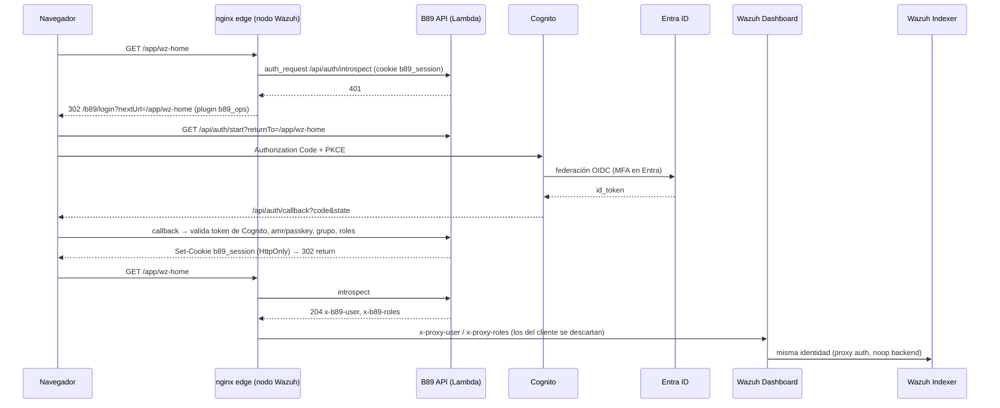

# 04 · Identidad y acceso

> Estado: la lógica de `modules/access` (OIDC PKCE, sesión, roles, Graph delta) es **hecha y
> probada con tests**, sin verificar contra Cognito ni AWS real. **Cognito federado con Entra, las
> Lambdas de identidad y el borde CloudFront son propuestos** ([02](02-arquitectura.md)). Los
> requisitos de la SBS (autenticación fuerte, separación de funciones, trazabilidad) se confirman
> con B89.

## Modelo

- **Entra ID decide quién es la persona y si puede entrar** (grupo SOC, app roles y MFA).
  **B89 decide qué puede hacer**: capacidades, scope, SoD y auditoría.
- **Cognito (user pool) es el único emisor de tokens de B89** y se federa con Entra por OIDC. La
  API B89 (Lambda) valida los tokens de Cognito y mantiene la sesión opaca. Las personas no
  tienen contraseña local en Cognito: se autentican en Entra.
- **Un solo login para todo.** El mismo login protege la consola de casos **y** el dashboard de
  Wazuh. No hay usuarios locales de Wazuh para personas. Los usuarios internos quedan solo para
  servicios (`b89_reader` y `wazuh-wui`) y para el break-glass.
- **MFA obligatorio, aplicado en Entra** (Conditional Access). La regla "passkey fuera de la red"
  vive en la API (`network.ts`) y exige que el claim `amr` de Entra llegue hasta ella a través de
  Cognito (mapeo de atributos o Lambda `pre-token-generation`): **por validar en la integración**.

## Excepción temporal de MFA/passkey de la demo anterior

`B89_DEMO_MFA_EXCEPTION_UNTIL` (en `apps/api/src/main.ts` y el esquema de configuración) permitía
completar el login sin prueba de MFA/passkey con vencimiento acotado. La fecha de la demo anterior
(2026-10-17) **ya venció**. En B89 SOC no se propaga: no se define la variable en ningún entorno
nuevo y se evalúa retirar el código en la fase 1 ([09](09-plan-de-lanzamiento.md)).

## Flujo

El tráfico entra por CloudFront + WAF: `/api` va a API Gateway HTTP (Lambda) y `/` al dashboard.
Con Lambda la API no tiene memoria entre invocaciones, por lo que **el estado del login (handshake
OIDC, lockout, CSRF) y la sesión van a Aurora y Secrets Manager**, no a memoria (ver Pendientes).

## Piezas

| Pieza | Estado | Archivo |
| --- | --- | --- |
| OIDC PKCE, `state`/`nonce`, validación RS256, `amr` y passkey fuera de la red | Hecho, 79 tests | `modules/access/src/{oidc-handshake,id-token,sign-in,network}.ts` |
| Sesión opaca (30 min de inactividad, 8 h absolutas, hash en Postgres) | Hecho (Postgres = Aurora, propuesto) | `modules/access/src/session.ts` |
| `GET /api/auth/introspect` → 204 con `x-b89-user` y `x-b89-roles` | Trabajo en curso **sin commitear en `main`** | `apps/api/src/soc/auth.controller.ts` |
| User pool de Cognito, proveedor OIDC de Entra y app client | Propuesto (sin Terraform aún) |
| nginx `auth_request` | Propuesto en esta rama | `wazuh/edge/b89-edge.conf` |
| Security plugin `proxy` (Indexer y Dashboard) | Propuesto en esta rama | `wazuh/indexer/security/`, `wazuh/dashboard/opensearch_dashboards.b89.yml` |
| Revocación al salir del grupo (Graph delta) | Hecho. Se ejecuta con EventBridge Scheduler + Lambda y además llama a `AdminUserGlobalSignOut` de Cognito (propuesto) | `apps/api/src/runtime/directory-sync.ts` |

## Por qué proxy auth y no OIDC nativo de OSD

| Criterio | OIDC nativo de OSD | B89 como proxy de identidad |
| --- | --- | --- |
| Passkey obligatoria fuera de la red | No | Sí (`network.ts`) |
| Revocación al salir del grupo SOC | Solo al expirar el token | Rápida (≤ 5 s por la caché del edge): cada request pasa por `introspect` |
| Revocación administrativa de sesión | No | Sí, en `/api/admin/sessions` |
| Auditoría del acceso | Logs de OSD | Cadena hash B89 |
| Esfuerzo | Solo configuración | Configuración más el endpoint, que ya existe |

La configuración OIDC nativa queda como **fallback** documentado en
`wazuh/dashboard/opensearch_dashboards.b89.yml` (comentada).

## Mapeo de roles

| Rol Entra (`x-proxy-roles`) | Rol OpenSearch (`roles_mapping.yml`) | Rol Wazuh API (`run_as`) |
| --- | --- | --- |
| `b89.platform.admin` | `all_access` | `administrator` |
| `b89.soc.lead` | `b89_soc_lead` (lectura de `wazuh-*` y AD) | `readonly` + `active-response` (vía B89, no directo) |
| `b89.soc.analyst` | `b89_soc_analyst` (lectura de `wazuh-alerts-*`) | `readonly` |
| `b89.auditor` | `b89_auditor` (lectura sin export) | `readonly` |

## Administración de usuarios: estado, cambio de rol y revocación inmediata

Es un diferencial de negocio: ni Wazuh ni OSD lo tienen. **Cualquier cambio de acceso corta la
sesión al instante, en la consola y en el dashboard.**

### Lo que ya existe en el backend TS

| Función | Endpoint o mecanismo | Archivo |
| --- | --- | --- |
| Padrón del grupo SOC: membresía, `accountEnabled`, rol efectivo **y su origen**, última actividad, sesiones activas y si la sincronización está vieja | `GET /api/admin/users`, `GET /api/admin/users/:oid` | `apps/api/src/soc/admin-users.controller.ts` |
| Sesiones recientes y revocación manual | `GET /api/admin/sessions`, `POST /api/admin/sessions/:ref/revoke` | `apps/api/src/soc/admin-sessions.controller.ts` |
| **Salida del grupo en Entra → revocación automática** | Graph delta → `removedMembers` → `revokeSessionsByOid` (auditado) | `apps/api/src/runtime/directory-sync.ts` |
| Origen del rol: dueño del grupo, grupo admin, binding de deploy, app role de Entra o asignación aprobada por B89 | `explainRole` | `apps/api/src/runtime/role-grants.ts` |

### Cambios de rol con aprobación y auditoría

La implementación está en la rama `codex/b89-admin-roles-main`; todavía no cuenta como parte de
`main` ni del despliegue hasta que su PR y CI se completen. El panel del plugin Wazuh usa solicitudes
de cambio, no escribe grants directamente ni modifica miembros/estado de cuenta en Entra.

| Operación | Endpoint | Control |
| --- | --- | --- |
| Leer grant editable y sus fuentes fijas | `GET /api/admin/users/:oid/role-grant` | `users.read`, miembro vigente, padrón Graph fresco |
| Solicitar concesión o retiro | `POST /api/admin/users/:oid/role-requests` | `roles.request`, CSRF, motivo, revisión CAS y solicitante distinto del objetivo |
| Consultar bandeja del tenant | `GET /api/admin/role-requests` | Capability de solicitud o aprobación; paginación acotada |
| Resolver etapa pendiente | `POST /api/admin/role-requests/:id/approve` o `/reject` | Aprobador declarado para la etapa, SoD, CSRF, revisión CAS y motivo |

- Los grants dinámicos viven en `access_role_grants`, separados de las asignaciones del deploy,
  app roles de Entra y dueños del grupo. `access_role_requests` conserva estado y aprobaciones; el
  historial íntegro se registra en la cadena de auditoría.
- Cada decisión exige que solicitante, objetivo y aprobador sean personas distintas y continúen
  habilitados en el grupo sincronizado. Sin Graph reciente o sin aprobadores declarados, se falla
  cerrado. `B89_ACCESS_APPROVER_OIDS` y `B89_SECURITY_APPROVER_OIDS` se configuran por entorno;
  no se publican OIDs de usuarios en el repositorio.
- El rol `b89.platform.admin` exige dos aprobaciones (Acceso y Seguridad). La etapa de Seguridad
  además exige autenticación fuerte y reciente. El login actual no entrega evidencia step-up; por
  eso hoy esa aprobación está bloqueada intencionalmente. No se relaja ni se simula desde el panel.
- Tras aprobar el cambio final, el backend confirma grant y auditoría y luego revoca las sesiones
  en otro store. Si quedan sesiones sin revocar, la respuesta informa `sessionRevocation.remaining`
  y registra el fallo. No es una transacción atómica entre grant y sesión: cerrar este hueco y
  verificar la propagación del corte al Dashboard sigue siendo un gate antes de producción.
- La sincronización del padrón cancela solicitudes abiertas cuando sus participantes dejan de ser
  miembros. Deshabilitar o dar de baja una cuenta sigue siendo responsabilidad de Entra; B89 solo
  refleja ese estado y aplica la denegación/revocación correspondiente.

### Una sola sesión por persona (ya existe)

- Al abrir una sesión nueva, todas las sesiones `active` previas de la misma persona (mismo
  `subjectId` y tenant) pasan a `superseded` (`modules/access/src/session.ts:119`,
  `secops-runtime.ts:855`). El login redirige con `sessionNotice=superseded` para avisar.
- **En la plataforma unificada se extiende sola al dashboard.** El dashboard no tiene sesión
  propia y usa la de B89 por proxy auth. Si alguien entra desde otro navegador, la primera
  sesión pierde la consola **y** el dashboard (≤ 5 s por la caché del edge). El estado
  `superseded` se ve en «Sesiones» y queda auditado.
- **Riesgo a cerrar (fase 1):** el reemplazo se hace en un bucle después de crear la sesión nueva,
  no de forma atómica. Dos logins casi simultáneos podrían dejar dos sesiones activas. Hay que
  agregar un índice único parcial en Postgres `(tenant_id, subject_id) WHERE state = 'active'` y
  hacer el reemplazo en la misma transacción.

### Estado que ve el admin

| Estado | Regla |
| --- | --- |
| **En línea** | Sesión activa con `lastSeenAt` dentro del idle de 30 min |
| **Inactiva** | Sesión activa pero sin actividad reciente |
| **Sin sesión** | Ninguna sesión activa |
| **Sin rol** | Origen `none`. Entra al grupo, pero B89 la deniega con `NO_ROLE_ASSIGNED` |
| **Deshabilitada en Entra** | `accountEnabled = false` |
| **Fuera del grupo** | `membership = removed`. Sesiones ya revocadas |

## Pendientes y riesgos

0. **IP del cliente detrás del edge.** La política de red depende de ver la IP real del usuario. Con
   CloudFront y API Gateway la IP llega en `X-Forwarded-For` / `requestContext.http.sourceIp`; la
   API debe confiar solo en el salto de CloudFront (lista de prefijos gestionada) o tratará a todos
   como externos y exigirá passkey. Se resolvió en la topología anterior con Cloud Map; el
   equivalente serverless es **propuesto** y se prueba en la fase 1.

1. **Stores en memoria.** El handshake OIDC, el lockout y la clave CSRF se crean en memoria al
   arrancar (`secops-runtime.ts:246-275`). En Lambda, cada invocación puede caer en un contenedor
   distinto: el login y el CSRF **fallarían**. Moverlos a Aurora y Secrets Manager es **bloqueante**
   para el despliegue serverless.
2. **Coste del `introspect`.** Cada request del dashboard dispara una invocación de Lambda y una
   lectura de Aurora. nginx lo cachea 5 s por cookie (`proxy_cache`). Una revocación tarda como
   máximo 5 s en aplicarse. Si Aurora escala a cero, la primera invocación tras inactividad añade
   segundos de latencia: en producción conviene un mínimo de ACU mayor a cero (ver [06](06-operacion.md)).
3. **Cabeceras de confianza.** nginx **borra** las `x-proxy-*` que manda el cliente. El Indexer
   solo acepta proxy auth desde `internalProxies` (127.0.0.1).
4. **Redirect URI.** La app de Entra registra el endpoint de Cognito (`https://<dominio-cognito>/oauth2/idpresponse`) y el app client de Cognito registra `https://<dominio-soc>/api/auth/callback`. Dominio placeholder: `b89.example`.
5. **Sin step-up.** No hay reautenticación para acciones sensibles (aprobar SOAR, conceder roles).
   Hay que añadir `max_age`/`prompt=login` en la fase 3.
