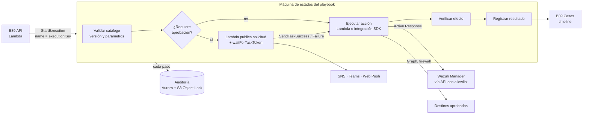

# 13 · B89 Respond: capa de respuesta gobernada

> Estado: el diseño sobre **AWS Step Functions es propuesto**. El overlay de Shuffle que existe hoy en
> el repo es **estado heredado, a reemplazar** (sección 5). Arquitectura de referencia:
> [02](02-arquitectura.md); conexión con el núcleo B89: [14](14-b89-respond-conexion-b89.md).

**B89 Respond** es la capa de respuesta de B89 SOC: convierte una decisión humana sobre una alerta o caso
en una acción ejecutada, auditada y reversible. Ya no es un SOAR en una VM: cada playbook es una
**máquina de estados de Step Functions (Standard)** invocada por la B89 API, sin servidor que operar.

**Alcance:** catálogo de acciones, playbooks, aprobación humana, ejecución, auditoría y avisos.
**Fuera de alcance:** los módulos para el equipo de riesgos no financieros, que define el dueño con Franco.

## 1. Principios (heredados del ADR-028 y de 02)

- **B89 decide y deja evidencia; la máquina de estados ejecuta.** Catálogo, versiones autorizadas,
  separación de funciones (nadie aprueba lo que pidió) y auditoría viven en `modules/soar` y Aurora.
- **Aprobación humana antes de todo efecto.** Los playbooks de enriquecimiento (solo lectura) no la
  requieren; cualquier acción con efectos, sí.
- **Idempotencia:** la ejecución se nombra con el identificador de la solicitud (`executionKey`);
  Step Functions rechaza una segunda ejecución con el mismo nombre y entrada distinta.
- **Un timeout es `UNKNOWN`**: se reconcilia consultando la ejecución antes de repetir; sin reintentos ciegos.
- **Mínimo privilegio:** cada estado usa un rol IAM propio; los secretos se referencian en Secrets
  Manager y nunca viajan en la entrada de la ejecución. Active Response nunca recibe credenciales del
  Indexer; pasa por el Manager con allowlist.

## 2. Diseño propuesto

| Elemento | Diseño |
| --- | --- |
| Máquina de estados por playbook | Una definición ASL versionada por `playbookId` y `playbookVersion`, en el repo y desplegada por Terraform. La versión la fija el catálogo, nunca el navegador |
| Aprobación humana | Estado con `.waitForTaskToken`: una Lambda guarda el token en Aurora y notifica por SNS. `POST /api/actions/:id/approve` (step-up, aprobador distinto del solicitante) llama `SendTaskSuccess`; el rechazo, `SendTaskFailure`. `TimeoutSeconds` lleva la solicitud a `EXPIRED` |
| Ejecución idempotente | `StartExecution` con `name = executionKey` (id de solicitud). Un reintento con el mismo nombre no duplica el efecto |
| Catálogo de acciones | `actionId`, `playbookRef`, `paramsSchema` (solo referencias opacas), `risk`, `capability`, `approval` y `timeouts`; versionado y auditado en Aurora (contrato en [14](14-b89-respond-conexion-b89.md)) |
| Auditoría de cada paso | Cada transición escribe un `AuditEvent` en la cadena SHA-256 (misma transacción que la mutación) y el historial de la ejecución se archiva en S3 Object Lock |
| Active Response de Wazuh | Un estado invoca una Lambda en VPC que llama a la API del Manager (ruta privada) con un comando de la allowlist; B89 Respond no tiene credenciales del Indexer |
| Notificaciones | SNS para el aviso de aprobación y el resultado; entrega a Teams y Web Push desde el notificador B89 (ADR-022), sin un segundo aviso crítico por la misma referencia |
| Reintentos y fallos | `Retry` con backoff solo en pasos idempotentes; `Catch` lleva a compensación o a `UNKNOWN`. DLQ en SQS para eventos que no se pudieron iniciar |
| Observabilidad | Registro de ejecución en CloudWatch Logs (sin payloads sensibles) y alarmas por ejecuciones fallidas o `UNKNOWN` |

### Costo y límites

Standard cobra por transición y encaja aquí: baja frecuencia, esperas humanas largas y historial
auditable. No se usa Express para acciones con efectos.

## 3. Fases del plan (migración)

| Fase | Contenido | Acepta cuando |
| --- | --- | --- |
| **M0 · Congelar lo heredado** | Marcar el overlay Shuffle como legado; no ampliarlo | Docs y READMEs lo declaran heredado |
| M1 · Núcleo de catálogo | Catálogo versionado en `modules/soar`, máquina de estados y `executionKey` en dominio, sin infraestructura | Tests de dominio: idempotencia, SoD, `UNKNOWN` |
| M2 · Infra Step Functions | Terraform en `infra/aws`: máquinas, roles, SNS, Lambda de aprobación | Plan sin ingress público; ejecución sintética en sandbox |
| M3 · Primeros playbooks | `enrich.ip-reputation` (sin efectos) → `endpoint.block-ip` (Active Response vía Manager) → `m365.revoke-sessions` (Graph), cada uno con aprobación | Ciclo completo con auditoría y SoD |
| M4 · Dentro de `b89_ops` y B89 Cases | Catálogo, estado y bandeja de aprobaciones; resultado en el timeline del caso | El analista no necesita otra consola |
| M5 · Retiro de Shuffle | Migrar el triage inicial; retirar el adaptador Wazuh→Shuffle y el overlay | Triage sobre Step Functions en uso; sin dependencias de Shuffle |
| M6 · Automatizaciones OSS curadas | Contenido mantenido para Wazuh, M365, Sophos y Cato, adaptado como máquinas de estados ([roadmap](security/b89-respond-playbooks/opensource-roadmap.md)) | Validación con eventos sintéticos, permisos mínimos, aprobación y rollback |

## 4. Riesgos y decisiones abiertas

1. **Editor visual:** Workflow Studio sirve para diseñar, pero la fuente de verdad es el ASL versionado
   en Git. Falta decidir si el equipo de automatización necesita una UI propia.
2. **Catálogo de acciones (U-008):** cada acción con efectos necesita capacidad propia, aprobación y pruebas.
3. **Rol `b89.automation.engineer`:** pendiente de aprobación del dueño (ver [14](14-b89-respond-conexion-b89.md)).
4. **Licencia:** la AGPL-3.0 de Shuffle deja de aplicar al retirarlo (M5); el dictamen U-022 de Legal solo
   importa mientras se use el overlay.

## 5. Estado heredado (Shuffle): hecho, a reemplazar

Lo siguiente existe en el repo, se construyó para un perfil Azure archivado y **se reemplaza por el
diseño de la sección 2**. No se amplía.

| Pieza | Dónde | Estado |
| --- | --- | --- |
| Overlay de frontend sobre Shuffle v2.3.0 (3 parches, arte, codemod AST, CSP de mismo origen, código fuente AGPL en `/source/`) | `b89-respond/` | Hecho; el codemod pasa 8/8 tests y el build llega hasta la imagen |
| Adaptador Wazuh → webhook de Shuffle (alertas nivel 12+, metadatos mínimos) | `infra/wazuh/shuffle/` | Hecho; solo triage de lectura |
| Módulo Terraform de host Linux privado para el Compose de Shuffle | `infra/azure/modules/b89_respond_host/` | Hecho, desactivado (`b89_respond_host=null`); no instala ni arranca Shuffle |
| Catálogo de playbooks de triage (diseño) | `docs/security/b89-respond-playbooks/` | Diseño; no importado a ninguna instancia |
| Workflows de CI | `b89-respond-azure.yml`, `b89-respond-azure-iac.yml` | Construyen y validan frontend e IaC; no despliegan |

**Bloqueos conocidos del runtime Shuffle** (motivo adicional del reemplazo): el backend descarga `app_sdk`
desde `main` sin fijarlo; Orborus, el worker y `shuffle-security` no tienen compatibilidad demostrada con
v2.3.0; Compose usa tags mutables; y Orborus exige el socket de Docker (equivale a root en el host).
Nunca se desplegó: no hay prueba de login, ejecución, persistencia ni recuperación.

**Se reutiliza en la migración:** el catálogo y sus reglas de gobierno, `executionKey` como clave de
idempotencia, los playbooks de triage y la marca B89 Respond. **Se descarta:** frontend Shuffle, Orborus,
OpenSearch propio, el host dedicado y el webhook con HMAC (la API invoca Step Functions por IAM).
