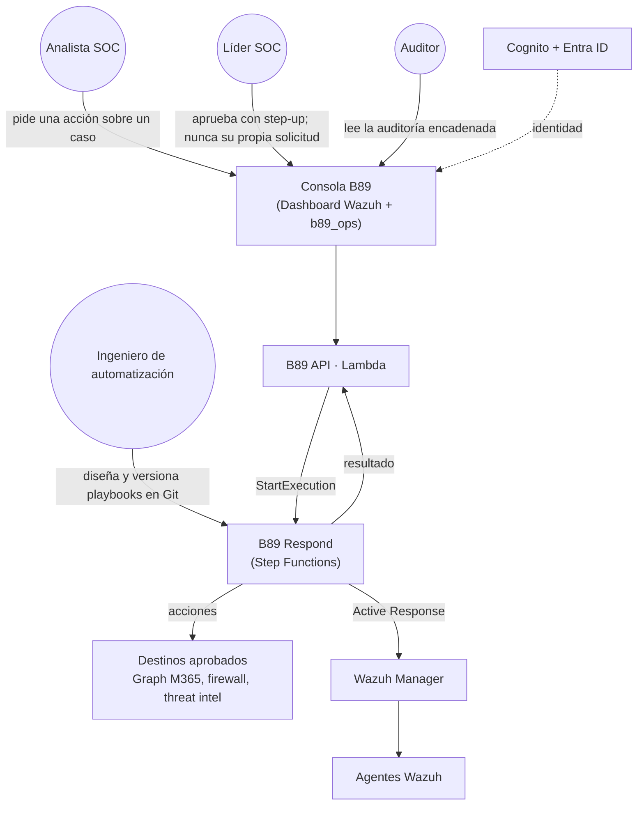
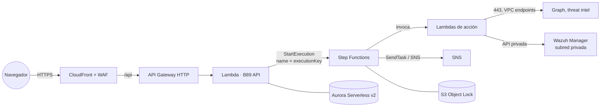
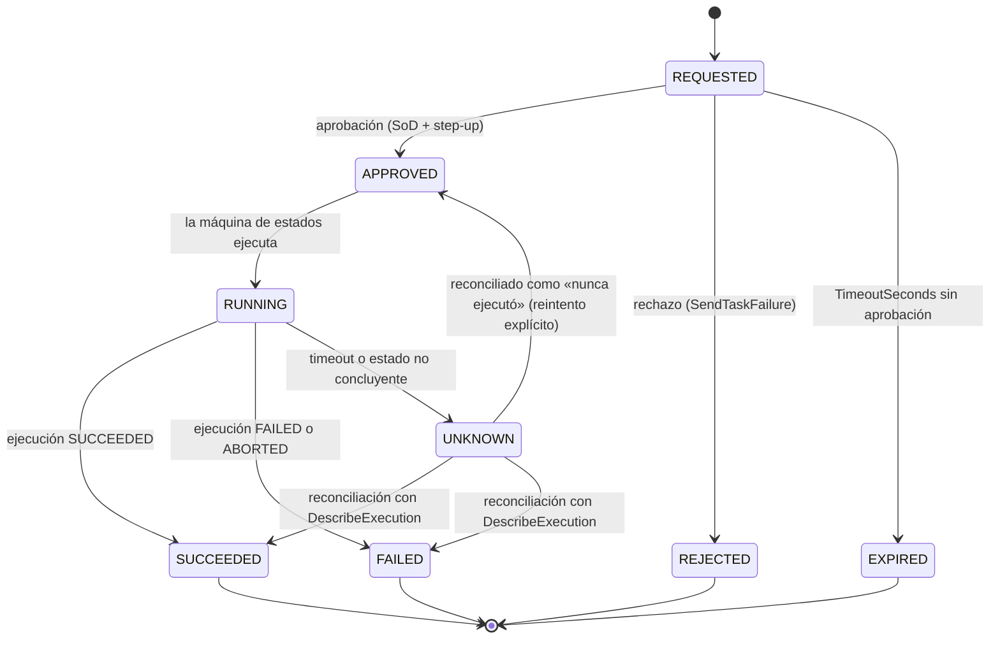

# 14 · Conexión de B89 Respond con B89 SOC

> Estado: el diseño sobre **Step Functions es propuesto**; la sección 8 recoge el **estado heredado
> basado en Shuffle** (hecho, a reemplazar). Contexto y fases de migración en [13](13-b89-respond.md);
> arquitectura general en [02](02-arquitectura.md).

Regla central: **la B89 API gobierna y deja evidencia; Step Functions ejecuta.** Una acción solo sale de
la B89 API después del catálogo y la aprobación; ni el navegador, ni Wazuh, ni otro servicio inician una
ejecución directamente.

## 1. Contexto: quién usa qué



| Persona | Entra a | Puede |
| --- | --- | --- |
| Analista SOC | Consola B89 (`b89_ops`) | Pedir acciones del catálogo y ver su estado |
| Líder SOC | Consola B89 | Aprobar con step-up (nunca lo que pidió) |
| Ingeniero de automatización (rol nuevo `b89.automation.engineer`, **pendiente de aprobación del dueño**) | Repositorio y consola AWS con rol de solo despliegue vía CI | Diseñar máquinas de estados como código y publicarlas como versión candidata. Una versión entra al catálogo solo con la aprobación del Líder SOC |
| Auditor | Consola B89 | Leer la auditoría de cada ejecución |

## 2. Despliegue y red



| Flujo | Origen → destino | Control |
| --- | --- | --- |
| Solicitud y aprobación | Navegador → CloudFront → API Gateway → Lambda | Cognito (JWT), capacidad y scope en servidor, step-up para aprobar |
| Inicio de ejecución | Lambda B89 API → Step Functions | Rol IAM de solo `states:StartExecution` sobre las máquinas del catálogo |
| Aprobación | Lambda B89 API → `SendTaskSuccess` / `SendTaskFailure` | El token vive en Aurora, nunca en el navegador |
| Acciones externas | Lambdas de acción → proveedor | Egress solo por endpoints de VPC y destinos aprobados; credenciales por `secretRef` en Secrets Manager con permiso mínimo |
| Active Response | Lambda en VPC → API del Manager | Ruta privada, comando de la allowlist, rol propio; sin credenciales del Indexer |
| Monitoreo | Ejecuciones → CloudWatch | Alarmas por fallo o `UNKNOWN` |

No hay listener de callback ni HMAC propio: la integración API ↔ Step Functions se autentica con IAM y la
espera de aprobación usa `waitForTaskToken`.

## 3. Secuencia de una acción

```mermaid
sequenceDiagram
  autonumber
  participant AN as Analista (b89_ops)
  participant API as B89 API
  participant DB as Aurora (auditoría)
  participant SF as Step Functions
  participant LS as Líder SOC
  participant X as Destino (p. ej. Graph)
  AN->>API: POST /api/incidents/:id/actions {actionId, params} + Idempotency-Key
  API->>API: capacidad, scope y validación de params contra el catálogo
  API->>DB: acción REQUESTED + AuditEvent (misma transacción)
  API->>SF: StartExecution(name = executionKey, playbook fijado)
  SF->>API: estado con waitForTaskToken (guarda el token, avisa por SNS)
  LS->>API: POST /api/actions/:id/approve (step-up; aprobador ≠ solicitante)
  API->>DB: APPROVED + AuditEvent
  API->>SF: SendTaskSuccess(token)
  SF->>X: acción (rol y credencial mínimos)
  SF->>SF: verificar efecto
  SF->>API: resultado (último estado)
  API->>DB: SUCCEEDED o FAILED + AuditEvent + timeline del caso
  API-->>AN: /api/changes actualiza la vista
```

## 4. Estados de una acción



`UNKNOWN` nunca se reintenta a ciegas (ADR-028). Antes de repetir, la API consulta `DescribeExecution` y
`GetExecutionHistory` por `executionKey` (el nombre de la ejecución) y concilia.

## 5. Contrato

**Catálogo** (Aurora; versionado y auditado):

| Campo | Ejemplo | Para qué |
| --- | --- | --- |
| `actionId` | `m365.revoke-sessions` | Identificador estable |
| `playbookRef` | ARN de la máquina de estados y su versión fijada | Qué se ejecuta. Nunca lo elige el navegador |
| `paramsSchema` | `{ userRef: entityRef }` | Solo referencias opacas (D-10b): la Lambda de acción resuelve el dato con su propia credencial |
| `risk` | `low`, `medium` o `high` | Define la aprobación y el step-up |
| `capability` | `soar.execute.m365` | Quién puede pedirla |
| `approval` | `lead`, más step-up si es `high` | SoD (N5) |
| `timeouts` | aprobación (`TimeoutSeconds`), ejecución | Cuándo pasa a `EXPIRED` o `UNKNOWN` |

**Entrada de la ejecución** (`StartExecution`, `name = executionKey`):

```json
{ "executionKey": "7f3c…", "actionId": "m365.revoke-sessions", "version": "3",
  "params": { "userRef": "ent_9a1…" }, "incidentRef": "inc_51…", "requestedBy": "usr_…" }
```

- Nada de raw, PII, secretos ni cookies en la entrada: el historial de la ejecución queda archivado.
- Cada estado escribe su resultado a la auditoría; un estado repetido es idempotente por `executionKey`.
- Un HTTP 200 de una integración solo acredita recepción; el estado «Verificar efecto» comprueba el
  resultado real contra el proveedor.

## 6. Fronteras de seguridad

| Frontera | Garantía |
| --- | --- |
| Navegador ↔ API | Cognito, sesión revocable (≤ 5 s, N9/N10), capacidad y scope en servidor, step-up para aprobar |
| API ↔ Step Functions | IAM: la API solo inicia y reanuda las máquinas del catálogo; las máquinas no pueden invocar otras sin permiso explícito |
| Credenciales de acción | Las tiene el rol de cada Lambda de acción (p. ej. Graph con permiso mínimo), vía Secrets Manager. **La API nunca tiene escritura sobre Graph** ni las acciones credenciales del Indexer. Active Response va por el Manager con allowlist |
| Datos | La entrada lleva referencias. La evidencia y la auditoría viven en Aurora (cadena hash) y S3 Object Lock |
| Supply chain | Las máquinas de estados y Lambdas se construyen en CI con versiones y hashes fijados; ASL versionado en Git |

## 7. Resiliencia

| Falla | Comportamiento |
| --- | --- |
| Lambda de acción falla | `Retry` con backoff en pasos idempotentes; luego `Catch` a compensación o `UNKNOWN` |
| Timeout ambiguo | `UNKNOWN` y reconciliación con `DescribeExecution`; sin reintento ciego |
| Inicio fallido | El evento queda en SQS con reintentos y DLQ |
| Aprobador no responde | `TimeoutSeconds` lleva la solicitud a `EXPIRED` y avisa |
| Wazuh Manager no disponible | El paso de Active Response falla cerrado y queda registrado; no hay acción parcial silenciosa |

## 8. Estado heredado (Shuffle): hecho, a reemplazar

El diseño anterior, **nunca desplegado**, ponía a Shuffle en un host privado detrás del edge del SIEM:

- Edge con `auth_request` sirviendo `/b89-respond/*` hacia el frontend rebrandeado de Shuffle.
- Despacho: núcleo B89 → cola Valkey → webhook de Shuffle con HMAC (`X-B89-Signature`), `executionKey` y
  una app de validación en Python; callback firmado hacia un listener privado `:8443` (contrato no
  implementado).
- Estados `REQUESTED → APPROVED → DISPATCHED → SUCCEEDED/FAILED/UNKNOWN`, con reconciliación por la API de
  Shuffle.
- Variante Azure: dos hosts privados (`siem_host` y `b89_respond_host`), Azure Firewall con DNAT y UDR;
  Terraform solo preparaba VM, red, disco y Compose. Estaba desactivada (`siem_host=null`,
  `b89_respond_host=null`).

Cobertura en el repo: `b89-respond/` (frontend), `infra/wazuh/shuffle/` (adaptador de alertas nivel 12+),
`infra/azure/modules/b89_respond_host/`, y los playbooks de triage en
`docs/security/b89-respond-playbooks/`. Todo se retira en la fase M5 de [13](13-b89-respond.md).

Equivalencias en la migración:

| Heredado (Shuffle) | Propuesto (Step Functions) |
| --- | --- |
| Cola Valkey `b89-respond` con `jobId = executionKey` | `StartExecution` con `name = executionKey` |
| Webhook firmado con HMAC y app de validación | IAM entre la API y Step Functions |
| `DISPATCHED` y callback firmado | Estados de la ejecución y `SendTaskSuccess` |
| Reconciliación por la API de Shuffle | `DescribeExecution` y `GetExecutionHistory` |
| Frontend Shuffle bajo `/b89-respond/` | Panel en `b89_ops` y timeline en B89 Cases |
| Orborus, workers y OpenSearch propio | Lambdas de acción |

## 9. Decisiones abiertas

1. **Rol `b89.automation.engineer`:** requiere aprobación del dueño y mapeo en Cognito/Entra.
2. **Aprobación en `b89_ops`:** definir si la bandeja del Líder SOC vive en el plugin o en B89 Cases.
3. **Adaptador Active Response:** forma exacta de la API del Manager y la allowlist de comandos (M3).
4. **Cuenta de ejecución:** si las máquinas de estados corren en `b89-soc-workload` o en una cuenta de
   respuesta separada.
