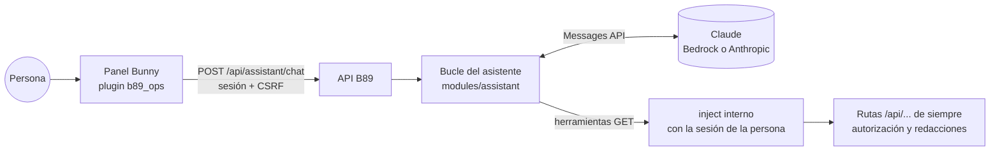

# 15 · Bunny, el asistente de IA

> Leyenda: **[verificado]** (probado con pruebas automáticas en este repo), **[sin verificar]**
> (existe en el repo, no se probó contra el proveedor real ni en el dashboard desplegado) y
> **[propuesto]**.

**Bunny** es el asistente de IA integrado en B89 SOC, con el conejo Remi de la identidad de marca.
Se comporta como un asistente de consola tipo Amazon Q: un panel lateral que se abre desde la
cabecera, entiende en qué página estás, consulta el SOC por ti con herramientas, muestra qué
consultó y cita las alertas e incidentes en que se apoya. Usa **Claude** por API.

## Qué puede hacer

| Pregunta típica | Herramientas que usa |
| --- | --- |
| «¿Qué alertas P1 hay abiertas?» | `list_alerts`, `get_alert` |
| «Resume el incidente y sus tareas» | `get_incident`, `get_incident_alerts`, `get_incident_timeline`, `get_incident_tasks`, `get_incident_notes` |
| «Busca inicios de sesión fallidos en 24 h» | `search_events` |
| «¿Hay fuentes degradadas?» / «¿cómo va la plataforma?» | `sources_health`, `operations_health` |
| «¿Quién cambió roles esta semana?» / «verifica la auditoría» | `audit_events`, `audit_verify` |
| «¿Qué avisos no tuvieron acuse?» | `list_notifications` |
| Usuarios, sesiones y solicitudes de rol (administración) | `list_users`, `list_sessions`, `list_role_requests` |
| «¿Por qué no puedo ver X?» | `whoami` |

«Toda la información del SOC» significa **todo lo que la persona que pregunta puede ver** con su
rol, no más. Es una decisión de seguridad, no una limitación.

## Cómo está hecho

- **Mismo permiso que la persona.** Cada herramienta compone una URL `GET` de una lista cerrada y la
  ejecuta con la **cookie de sesión de quien pregunta**. La autorización, la proyección de campos y las
  redacciones son las de la API de siempre; Bunny no tiene un acceso privilegiado propio. Solo se
  ofrecen al modelo las herramientas que el rol puede usar, y las demás se rechazan como desconocidas.
- **Solo lectura por construcción.** No hay herramientas con otro método que `GET`, y el cliente interno
  rechaza cualquier ruta fuera de `/api/`. Una acción de respuesta se explica y la solicita un analista
  y la aprueba otra persona en B89 Respond ([13](13-b89-respond.md)).
- **Datos personales seudonimizados.** Correos e IPv4 se sustituyen por marcadores estables
  (`<usuario_1>`, `<ip_1>`) antes de salir hacia el modelo y se restituyen en la respuesta. Alcance
  honesto: no detecta nombres propios u otros identificadores en texto libre.
- **Contenido de terceros = dato.** Los resultados de herramientas se marcan como datos, no como
  instrucciones; el prompt de sistema manda ignorar y avisar de intentos de inyección.
- **Presupuesto acotado.** Máximo 5 rondas de herramientas, resultados truncados a 12 000 caracteres,
  24 s de reloj total (API Gateway corta a 30 s) y 20 preguntas por persona cada 10 min (por instancia
  de Lambda: un tope global exigiría un almacén compartido).
- **Auditoría.** Cada pregunta deja `assistant.ask` con quién, resultado y herramientas usadas; el
  texto de la conversación **nunca** va a auditoría ni a logs (vive solo en el historial, abajo).

## Proveedores y configuración

| Variable | Valor | Nota |
| --- | --- | --- |
| `B89_BUNNY_ENABLED` | `true` | Apagado por defecto: sin él no existe el endpoint ni el botón |
| `B89_BUNNY_PROVIDER` | `bedrock` (defecto) o `anthropic` | Nodo AWS PowerUser (sin IAM para Bedrock): `anthropic` |
| `B89_BUNNY_MODEL` | `claude-opus-5-5` en Bedrock; `claude-sonnet-5-5` con `anthropic` | En Bedrock se antepone `anthropic.` |
| `B89_BUNNY_EFFORT` | `medium` (defecto) | `low`…`max`; más esfuerzo = más tokens |
| `B89_BUNNY_REDACT_PII` | `true` (defecto) | Seudonimización |
| `B89_BUNNY_API_KEY` | secreto | Solo con `anthropic`. En el despliegue AWS se toma de `B89_CLAUDE_API` (`/opt/b89/secrets/services.env`) y vive solo en `/opt/b89/secrets/api.env` (0600) |
| `B89_BUNNY_TIMEOUT_MS` | `20000` (defecto) | 1000–120000; tiempo por intento HTTP; el SDK reintenta 2 veces con backoff |
| `B89_BUNNY_RATE_LIMIT` | `20` | Preguntas por persona cada 10 min |
| `B89_BUNNY_HISTORY_ENABLED` | `true` (defecto) | Historial de conversaciones; `false`: el chat no guarda y `/conversations` responde 404 |
| `B89_BUNNY_RETENTION_DAYS` | `90` (defecto) | 1–365; las conversaciones sin actividad más antiguas se borran |

**Recomendación: Amazon Bedrock.** Con la arquitectura sin NAT ([02](02-arquitectura.md)) la Lambda no sale a
Internet, y la decisión N1 (operación autogestionada, sin SaaS de terceros para datos del SOC) y la
minimización N2 piden que los datos no salgan de la cuenta. Bedrock cumple ambas con el rol IAM de la
función (sin clave que guardar). El proveedor `anthropic` directo envía datos del SOC a un tercero:
**requiere dictamen de Legal** y salida a Internet.

Modelo: `claude-opus-5-5` es el valor por defecto de este proyecto; para bajar costo se puede usar
`claude-sonnet-5-5` o `claude-haiku-5-5` cambiando solo la variable. Cada pregunta con herramientas suele
costar varias llamadas al modelo (una por ronda); el costo real se debe **medir** con tráfico real, no
estimarlo.

## Historial de conversaciones

Como el asistente de la consola de AWS: cada persona ve la lista de sus conversaciones previas, las
reabre, las continúa, las renombra y las borra (una o todas).

**Modelo de datos.** Una conversación (`StoredConversation`: `id` UUID, `tenantId`, `ownerId` = `subjectId`
de la sesión, `title`, `createdAt`, `updatedAt`, `messages`) guarda sus mensajes (`StoredMessage`: `id`,
`role`, `text`, y en las respuestas `reasoning`, `steps`, `citations` y `tone`). Dominio y adaptador en
memoria en `modules/assistant/src/conversations.ts`; adaptador durable en
`modules/assistant/src/infrastructure/postgres-conversation-store.ts` (`@b89/assistant/postgres`), tabla
`assistant_conversations` con los mensajes en una columna `jsonb` e índices por
(`tenant_id`, `owner_id`, `updated_at`) y (`tenant_id`, `updated_at`). Se usa PostgreSQL cuando la
persistencia del SOC es `postgres`; en desarrollo y pruebas, memoria.

**Turno atómico.** El servidor guarda la pregunta y la respuesta **después** de obtener la respuesta, en
una sola escritura (alta de la conversación o compare-and-set sobre `message_count`). Si el guardado
falla, la respuesta llega igual con `saved: false`. Con el historial activo el servidor usa el historial
**guardado** e ignora el `history` que envíe el cliente; una conversación nueva empieza vacía.

**Aislamiento absoluto.** Toda consulta filtra por (tenant, dueño). Nadie más que el dueño lista, lee,
continúa, renombra o borra una conversación, **ni siquiera un administrador**. Un id ajeno, vencido o
inexistente responde lo mismo: `404 RESOURCE_UNAVAILABLE` (no se enumera).

**Límites.** 100 conversaciones por persona (al crear la 101.ª se descarta la menos reciente, auditado);
200 mensajes por conversación (el turno siguiente se rechaza con `422 VALIDATION_FAILED`,
`fields: ["messageLimit"]`, antes de llamar al modelo: hay que empezar otra); 20 000 caracteres por
mensaje (la respuesta del modelo se recorta a ese máximo); título automático = primeros 60 caracteres
de la primera pregunta en una línea; título manual de 1 a 80 caracteres.

**Retención y borrado.** `B89_BUNNY_RETENTION_DAYS` (defecto 90): al listar y al guardar se purgan, como
mucho una vez por minuto y proceso, las conversaciones del tenant sin actividad en ese plazo; una
vencida aún no purgada ya responde como inexistente. Borrar (una, todas o por retención) es **borrado
real**: es la única tabla donde el rol `b89_soc_runtime` tiene `DELETE` (sin `TRUNCATE`), concedido en
`platform/database/bootstrap/post-migrate.sql`.

**Privacidad.** Se guarda el texto tal como lo vio la persona (con correos e IP reales, igual que el resto
del SOC; la seudonimización solo aplica a lo que sale hacia el modelo). Los datos viven dentro de la
cuenta, en el mismo PostgreSQL del SOC, **cifrado en reposo por el motor** (RDS con KMS). Auditoría sin
texto: `assistant.conversation.delete` (id o `all`, `metadata.count`) y `assistant.conversation.purge`
(`retention` o `limit`, `metadata.count`).

**Contrato HTTP** (todo exige sesión; lo que muta, además `x-csrf-token`; todas las respuestas llevan
`correlationId`):

| Método y ruta | Cuerpo / consulta | Respuesta |
| --- | --- | --- |
| `POST /api/assistant/chat` | `{message, page?, conversationId?, history?}` | lo de siempre + `{conversationId, title, saved}` (`null`, `null`, `false` si no se guardó) |
| `GET /api/assistant/conversations` | `?pageSize=1..200&cursor=` | `{items: [{id, title, updatedAt, messageCount}], nextCursor}` (más recientes primero) |
| `GET /api/assistant/conversations/:id` | | `{id, title, createdAt, updatedAt, messages: [{id, role, text, reasoning?, steps?, citations?, tone?, createdAt}]}` |
| `PATCH /api/assistant/conversations/:id` | `{title}` (1–80) | `{id, title}` |
| `DELETE /api/assistant/conversations/:id` | | `{deleted: 1}` |
| `DELETE /api/assistant/conversations` | | `{deleted: n}` (solo lo mío) |

`GET /api/assistant/config` añade `history` (booleano) y `retentionDays`.

## Interfaz

Botón con Remi en la cabecera (atajo Alt+Shift+B), panel lateral con saludo, ejemplos según la página
(alertas, incidentes, fuentes, auditoría), estado «consultando…», lista plegable de lo que consultó,
fuentes citadas con enlace a la consola, copiar, nueva conversación y aviso permanente de IA generativa
y solo lectura. Accesible por teclado, con foco visible y sin animación bajo `prefers-reduced-motion`. El
botón solo aparece si la API lo habilita y la persona tiene permisos de lectura.

## Estado

- **[verificado]** El dominio (bucle, presupuesto, seudonimización, inyección, errores): 11 pruebas. La API
  (configuración, adaptador, herramientas, cliente interno, permisos por rol, CSRF, límite de tasa y
  auditoría sin texto): 16 pruebas. La lógica del cliente de la interfaz: 4 pruebas. La interfaz se
  renderizó con React en un navegador de pruebas (saludo y conversación). Historial: almacén en memoria
  (aislamiento, topes, título, orden, paginación, purga) y configuración nueva con pruebas unitarias;
  por HTTP, crear/continuar/listar/leer/renombrar/borrar, aislamiento frente a otra persona y a un
  administrador, CSRF, paginación, historial apagado, guardado fallido (`saved: false`), conversación
  llena, retención y que el historial guardado reemplaza al del cliente
  (`apps/api/test/assistant-history.spec.ts`).
- **[verificado]** El adaptador PostgreSQL del historial y su migración contra PostgreSQL 18.6 real
  (Docker local): `postgres-conversation-store.integration.spec.ts` (5 pruebas) y el permiso `DELETE` del
  runtime en `postgres-roles.integration.spec.ts`. La migración no presenta deriva frente al esquema
  Prisma en `assistant_conversations`. La interfaz del historial en el panel tiene pruebas de su cliente
  (`chat_client.test.ts`).
- **[sin verificar]** Llamadas reales a Claude (Anthropic o Bedrock): las pruebas usan un modelo falso.
  El acceso a los modelos en Bedrock se habilita en la consola de AWS por cuenta y región. La interfaz dentro
  del dashboard de Wazuh desplegado (el typecheck de OSD y el SCSS compilado por OSD no se ejecutaron).
- **[propuesto]** Streaming de respuestas (requiere URL de función con streaming; API Gateway HTTP las
  almacena completas), límite de tasa global, retroalimentación (👍/👎) con backend, herramienta para
  *proponer* —nunca ejecutar— una acción de B89 Respond, y la opción `fallbacks` del proveedor ante rechazos del modelo.

## Validación al arrancar y minimización

`platform/configuration` reconoce todas las variables `B89_BUNNY_*` (`schema/assistant.schema.ts`) y las
valida al arrancar: un valor inválido o `B89_BUNNY_PROVIDER=anthropic` sin clave falla con
`CONFIG_VALUE_INVALID`/`CONFIG_REQUIRED_VALUE_MISSING` sin mostrar el valor. Proveedores admitidos:
`bedrock` y `anthropic` (DeepSeek se descartó). Además de la seudonimización de correos e IPv4, el
adaptador elimina credenciales evidentes (Bearer/Basic, JWT, claves AWS/GitHub/Slack/`sk-…`, claves
privadas, `password=`/`token:`/`api_key=`) de todo texto saliente (`apps/api/src/assistant/outbound-scrub.ts`);
el razonamiento firmado se reenvía intacto. Nunca se registran prompts ni respuestas.
