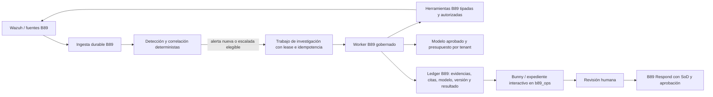

# 27 · Evaluación de AiSOC y plan para un analista B89 continuo

**Estado: propuesta técnica; no aprobada como cambio de arquitectura ni desplegada.**
Evaluación documental y de lectura estática del repositorio público el 2026-11-13. No se
ejecutó código de terceros, no se levantaron contenedores y no se conectaron credenciales o
datos reales de B89.

## Decisión propuesta

No desplegar AiSOC completo en paralelo con B89. B89 ya es el SIEM y el sistema de registro
de alertas, incidentes, evidencias y auditoría. El stack de AiSOC añadiría otro pipeline,
reglas, casos, agentes, almacenamiento y UI. Eso duplicaría la fuente de verdad y exigiría
mantener sincronización, identidad, retención y respuesta en dos productos.

Usar AiSOC como referencia de diseño para ampliar B89 con un **analista asistido de ejecución
continua**, alojado dentro de los límites de B89. El punto de entrada seguirá siendo el
dashboard B89 y Bunny. Las investigaciones de fondo se iniciarían desde alertas nuevas o
escaladas que sobrevivan filtros deterministas; devolverían una propuesta con evidencia y
progreso. En la primera entrega, el agente no cierra alertas, no cambia severidades, no
modifica Wazuh y no ejecuta contención. Las acciones continúan en B89 Respond con capacidad,
aprobación humana, separación de funciones e idempotencia.

El protocolo MCP no es por sí solo un trabajador 24/7. B89 ya implementa
`POST /api/assistant/mcp` para un cliente interactivo: Streamable HTTP stateless, sesión B89,
CSRF, filtrado por capacidades y herramientas SOC de solo lectura. Bunny reutiliza el mismo
dispatcher dentro del proceso. Ese contrato no proporciona identidad de workload para un
proceso sin persona conectada; no se debe guardar una cookie humana para automatizarlo.

## Evidencia revisada

| Área | Evidencia y lectura para B89 |
| --- | --- |
| Proyecto identificado | [`beenuar/AiSOC`](https://github.com/beenuar/AiSOC), rama `main`, commit revisado `6c939297d1fe2165bf2ed64c7d6d7d4a09196ead`, versión `23.4.0`. La página pública reportaba 7,5 mil estrellas y 2.002 commits al revisar. Son señales de actividad, no una auditoría independiente ni una garantía de soporte. |
| Licencia | MIT en el archivo `LICENSE` del commit revisado. Cualquier reutilización debe conservar aviso y licencia, revisar avisos de dependencias y registrar archivos derivados. La licencia no sustituye evaluación de seguridad, privacidad ni compatibilidad. |
| MCP de AiSOC | `services/mcp/README.md` describe un servidor para consultar el **propio** AiSOC: alertas, casos, investigaciones y ledger. El README dice que anuncia 19 herramientas; también tiene una inconsistencia de conteo entre “17 de 18” herramientas de lectura y la tabla. `aisoc_run_investigation` inicia un trabajo y requiere `cases:write` y aprobación. El paquete figura como listo pero aún no publicado; la instalación documentada es desde el monorepo clonado. No es un adaptador listo para leer B89. |
| MCP cliente de AiSOC | La guía de MCP externo documenta allowlist vacía por defecto, rechazo de herramientas marcadas como destructivas/no lectura, caps de respuesta, rechazo de SSRF, proyección de esquemas y registro de interacciones. También reconoce que escanear inyección no es defensa suficiente: su propio corpus externo retenido tuvo baja detección, así que la contención estructural y el límite de datos son controles principales. |
| Arquitectura | La guía de arquitectura describe ingestión, Kafka, fusión, Postgres, Redis, servicios de agentes y realtime, UI, LiteLLM/Ollama y Qdrant. El perfil completo añade ClickHouse, Neo4j y OpenSearch. Esta topología replica piezas que B89 ya posee; no es un MCP pequeño para agregar al nodo actual. |
| Operación continua | La documentación upstream informa una prueba HA en `kind` de tres nodos con una interrupción de réplica y 10.000 eventos. Aclara que no se probó en EKS/GKE/AKS, con almacenamiento persistente ni durante operación sostenida; la corrida fue de pocos minutos. No tomar ese resultado como evidencia de operación 24/7 de B89. |
| Costos y tokens | AiSOC informa modelo local Ollama y una descarga inicial aproximada de 2 GB; su guía de instalación pide Docker Compose, 8 GB de memoria y 20 GB de disco. No se midió costo ni carga en la EC2 de B89. Para B89 se deben medir tokens y coste por investigación con alertas sintéticas y límites explícitos antes de habilitar el consumo continuo. |
| Seguridad y supply chain | El repo contiene SECURITY.md, threat models, hardening y CI; son evidencia de prácticas declaradas por el proyecto, no un pentest independiente. Esta revisión no ejecutó tests, scanners, SBOM ni imágenes upstream. Cualquier prueba posterior debe fijar SHA/digests, escanear artefactos y ejecutarse aislada, sin credenciales ni telemetría B89. |

El análisis estático se hizo sobre una clonación shallow aislada en una carpeta temporal, fijada
al SHA anterior. No se ejecutaron `make`, npm/pnpm, Docker, scripts de instalación ni binarios.
No se copió código de AiSOC al repositorio B89.

## Ajuste a la arquitectura B89

Este diagrama es objetivo, no implementación existente. El worker debe consumir un trabajo
durable de la infraestructura vigente, no crear una segunda cola o clúster sin una decisión
de arquitectura. Antes de asignar el consumidor, verificar el estado real del worker,
outbox/inbox y migraciones en el commit desplegado. El Indexer y Manager siguen privados;
ningún MCP externo recibe acceso de red o credenciales directas a ellos.

El worker autentica como principal de servicio B89 con scopes acotados y tenant fijado por
la identidad, no por argumentos del modelo. Puede reutilizar las herramientas de lectura
B89, pero su autorización debe ser explícita y diferente de la cookie/CSRF de una persona.
Cada consulta se limita por ventana, cardinalidad, índices permitidos y proyección de campos.
El resultado es evidencia estructurada con IDs y timestamps, no un volcado de `_source` ni
un DSL provisto por el modelo.

## Límites de seguridad y de operación

- Las reglas y el correlador filtran/deduplican primero; el LLM solo analiza un conjunto
  pequeño de alertas agrupadas. La coincidencia temporal, una etiqueta del modelo o una
  respuesta incompleta no prueban causalidad ni compromiso.
- El worker procesa al menos una vez con clave idempotente, lease/fencing, retry acotado,
  backoff, cuarentena y recuperación tras reinicio. Una caída del modelo no bloquea la
  ingesta, el Indexer ni la cola humana.
- Los documentos de alerta, tool descriptions, notas y resultados MCP se tratan como datos
  no confiables. El diseño requiere límites de tamaño, JSON/schema allowlisted, fence de
  datos, detección y registro de intentos de prompt injection; el detector nunca es el único
  control.
- El modelo no añade allowlists, no corrige su propia severidad, no descarta alertas y no
  hace writes a Wazuh/M365/Entra. El analista acepta/corrige sugerencias y la señal humana
  queda versionada con regla, modelo y prompt para evaluar falsos positivos.
- El ledger guarda IDs de evidencia, herramientas, duración, tokens, versión de política y
  citas verificadas. No guarda razonamiento privado ni secretos; el contenido sensible se
  redacta antes del proveedor. La salida sin citas válidas queda como no verificada.
- La UI B89 muestra estados `pendiente`, `investigando`, `parcial`, `degradado`, `requiere
  revisión`, `completo` y `fallido`; avance por etapa y datos consultados, cancelar/reintentar
  con idempotencia, timeline navegable, cobertura faltante, citas profundas y exportación
  progresiva existente de informe. No simula progreso con un contador artificial.
- El sistema debe tener límites globales y por tenant de trabajos concurrentes, consultas,
  tokens, duración y gasto; circuit breaker y alarma por backlog/edad. “24/7” significa un
  proceso recuperable y monitoreado, no que la IA sustituya guardias o atención humana P1.
- Antes de cada llamada al proveedor, reservar presupuesto en una transacción PostgreSQL:
  validar límites de despliegue, tenant, analista y prioridad; insertar una reserva idempotente
  ligada al run/modelo; solo entonces permitir el dispatch. La reserva incluye máximos de
  entrada y salida, no un promedio. Al terminar se libera el excedente según usage recibido;
  ante timeout ambiguo queda pendiente de reconciliar, no se vuelve a invocar a ciegas. Este
  mismo mecanismo impide que dos réplicas consuman simultáneamente la última cuota.
- Reportar tres medidas distintas por run y en el panel: **usage reportado por proveedor**
  (tokens input/output/cache), **coste estimado** (tarifa versionada aplicada al usage o a
  la reserva) y **facturación confirmada** (solo con dato importado/recibido del proveedor).
  Sin feed de facturación, la UI dice “estimado” o “no disponible”; no presenta la estimación
  como costo real. Ollama local se informa como consumo de recursos medido, no como costo API
  cero.
- Aplicar cuotas jerárquicas de despliegue/tenant/analista y tier P1/P2, límites de concurrencia
  y techo diario/mensual. Prioridad puede consumir una reserva aprobada, pero no saltarse el
  hard cap. Si no alcanza la cuota, no invocar el modelo: mantener la alerta y el expediente
  en `requiere revisión` o `presupuesto agotado` y notificar por el canal normal según política.
- Enrutar cada fase mediante una política versionada: modelo económico para clasificación o
  resumen breve; modelo más capaz solo para investigaciones de alto impacto o ambiguas que
  pasen umbrales deterministas; revisión humana si faltan pruebas o la confianza es baja. El
  modelo no elige su propio tier ni presupuesto. Sin proveedor aprobado, el trabajo queda
  explícitamente degradado/sin IA.
- La caché es tenant-scoped y capability-scoped. Su clave incluye tenant, capacidades
  efectivas, filtros canónicos, watermark de origen, modelo/prompt/esquema y versión de
  política. Se invalida por frescura de origen, cambios de caso/regla/capacidad y TTL. No
  guardar secretos ni respuestas con PII en una caché compartida; no servir hits entre
  tenants. Atribuir tokens enviados, hits y ahorro estimado por separado, sin afirmar ahorro
  hasta compararlo con una ejecución baseline reproducible.
- Tool results se proyectan por allowlist de campos, páginas y límites de bytes **antes** de
  entrar al prompt. Si se corta la respuesta, adjuntar `truncated=true`, filas/bytes recibidos
  y cursor siguiente; nunca truncar en silencio ni tratar una página parcial como resultado
  completo. La UI puede continuar con cursor bajo el mismo run y presupuesto.
- La primera fase de ejecución permanece en **shadow mode**: genera recomendación y
  expediente, sin notificar a terceros ni cambiar estado. La notificación y cualquier
  respuesta se habilitan luego de medir y revisar.

### Progreso, cancelación y experiencia de investigación

El API crea un `runId` antes de procesar y emite estados observables sin exponer chain of
thought: `queued` → `fetching_evidence` → `correlating` → `model_started` por fase →
`validating_citations` → `writing_ledger` → `completed`, o `partial`/`degraded`/`failed` con
motivo legible. Cada evento lleva `runId`, secuencia monotónica, timestamp, etapa, herramienta,
filas/bytes/cursor y resultado sanitizado. La consola usa SSE si el proxy desplegado lo
mantiene y conserva polling/reanudación por `runId` como fallback.

La vista de investigación muestra qué ya se consultó, qué falta y frescura de fuentes; un
timeline navegable con enlaces a evidencia original; contradicciones e hipótesis por separado;
cobertura faltante; citas validadas; y un control explícito para detener. Cancelar bloquea
nuevas reservas y detiene trabajos pendientes. Si el proveedor ya recibió la llamada, la UI
avisa que usage/cargo puede ser desconocido hasta reconciliar y conserva el ledger parcial
marcado como tal. Reintentar es idempotente y no repite fases confirmadas. PDF/XLSX se crean
desde el expediente autorizado e incluyen truncamiento, estado de evidencia, fuente y hora;
no desde la respuesta cruda del modelo.

## Plan por etapas

| Etapa | Trabajo | Gate de salida |
| --- | --- | --- |
| 0. Baseline B89 | Confirmar en `main` y en el nodo desplegado el login Entra, herramientas MCP actuales, capabilities, tenancy, dispatcher, ingesta durable, alertas, outbox/worker y health. Registrar hashes, versiones y estado real; resolver OAuth antes de usar autenticación en el worker. | Sesión Entra real del grupo SOC validada con casos positivo/negativo y ACL por tenant probadas. No usar tokens de personas para automatización. |
| 1. Sandbox AiSOC | Mantener el clon upstream en cuarentena, pin de commit/digests, licencia y notices, SBOM, análisis de dependencias e imagen, revisión del threat model y reproducción de sus tests documentados si se autoriza. Usar datos sintéticos únicamente. | Informe de reproducción distingue resultados del upstream, resultados nuestros y fallos; no se integra runtime ni dato B89. |
| 2. Contrato del worker B89 | ADR/contrato de trabajo durable, identidad de workload, scopes, DTO de alerta agrupada, ledger/auditoría, estados, límites, configuración y métricas. Compatibilidad de migración y despliegue/reversión. | Revisión de seguridad y backend; tenant isolation y expiración/recovery de lease cubiertos con pruebas unitarias e integración PostgreSQL. |
| 3. Evaluación offline | Construir corpus adjudicado por analistas, estratificado por fuente/severidad y con negativos difíciles. Comparar reglas/correlador solos contra reglas + asistente; preservar cambios de scoring detrás de revisión. | Medir precisión, recall, FP/alerta útil, cobertura de citas, tasa de abstención, tiempo ahorrado, p50/p95 de investigación y tokens/costo por caso. Umbrales aprobados antes de evaluar; no afirmar reducción si el corpus no lo demuestra. |
| 4. Shadow mode en sandbox | Ejecutar el worker con eventos sintéticos y luego canario autorizado; sin autocierre ni respuesta. Validar retry, caída de Indexer/modelo/DB, backpressure, dedupe entre réplicas, prompt injection y reportes. | Sin pérdidas/duplicados en la cola; ACL negativa; ledger íntegro; alarmas de backlog; presupuesto y latencia dentro de límites aprobados; rollback ensayado. |
| 5. UI y adopción SOC | Integrar el estado del trabajo, evidencia/citas, progreso real y acciones humanas en Bunny y `b89_ops`; enviar sugerencias a analistas piloto, recoger veredictos y correcciones. | Aceptación de analistas; textos en español claros, teclado/lector, fallos y datos incompletos distinguibles; exportación PDF/XLSX validada con expediente real sintético. |
| 6. Operación continua | Habilitar el procesamiento continuo por fuente y severidad con cuotas progresivas, horario/cobertura, on-call, runbook y límites. Notificaciones siguen el pipeline normal de B89 y registran recepción/acuse. | Canary sostenido, SLO origen→alerta e investigación medidos, costo mensual aceptado, sin backlog creciente, restauración y rollback probados; aprobación del dueño SOC. |
| 7. Respuesta gobernada | Para cada acción nueva, crear contrato de capacidad, blast radius, reversibilidad, probe, permisos, SoD e idempotencia en B89 Respond. | Gate B12 y pruebas reales autorizadas por acción. No exponer dispatcher/write tools al modelo MCP. |

## Criterios cuantificables antes de la activación

Los valores de aceptación deben ser aprobados por el owner del SOC antes del benchmark. Como
mínimo se debe registrar:

1. Conteo de alertas entrantes, elegibles, deduplicadas, investigadas, omitidas y pendientes
   por motivo; distribución por fuente y prioridad.
2. Precisión/recall y falsos positivos en un set adjudicado independiente, incluyendo
   incertidumbre y métricas por plantilla/fuente para que una mayoría no esconda una
   regresión.
3. Porcentaje de afirmaciones materiales con una cita exacta y existente; tasa de hallazgos
   sin evidencia y abstenciones; muestras de inyección de prompt.
4. Latencia p50/p95 desde `occurredAt` hasta alerta visible, desde enqueue hasta resultado y
   desde resultado hasta notificación/acuse, con etapas separadas.
5. Tokens in/out reportados, coste estimado, facturación confirmada si está disponible,
   reservas pendientes/liberadas, llamadas al modelo, consultas a herramientas, caché y gasto
   por despliegue/tenant/analista/modelo/caso. Estimados y confirmados no se suman como si
   fueran una única medida.
6. Recuperación tras muerte del proceso, estado de leases, idempotencia bajo reintentos,
   límites de cuota y funcionamiento del circuit breaker.

## Decisión sobre lenguajes y tokens

Mantener TypeScript para contratos/autorización/UI y usar el correlador Go existente en su
función determinista. No portar el agente a Rust solo por expectativa de ahorrar tokens:
Rust no reduce tokens de entrada/salida y el flujo dominante es consulta, modelo y latencia de
proveedores. Primero reducir tokens con DTO compactos, agrupación determinista, cursor/paging,
batch de herramientas, caché de contexto estable, selección de modelo por riesgo y presupuesto
de salida medido. Reservar presupuesto antes de invocar y marcar truncamiento de tools antes
de formar el prompt. No afirmar ahorro de tokens/costo hasta comparar contra un baseline
reproducible de las mismas investigaciones y políticas. Evaluar Rust únicamente si un perfil
de carga muestra un cuello CPU/memoria
en parsing, normalización o fan-out que no se resuelve con límites y backpressure.

## Alternativas

| Alternativa | Evaluación |
| --- | --- |
| Desplegar el stack AiSOC completo junto a Wazuh/B89 | Rechazada para la topología actual: añade otro SIEM/casos/ledger/UI y varios datastore/colas; crea doble fuente de verdad y una superficie de operaciones nueva. Solo reevaluar con decisión formal de migrar B89, paridad de datos y presupuesto aprobado. |
| Conectar `@aisoc/mcp` a B89 como herramienta del agente 24/7 | No lista para uso directo: el servidor expone AiSOC, no B89; su publicación está pendiente y la identidad/contrato externo no hereda sesión/capabilities B89. No conectar usando cookie humana ni credencial admin. |
| Publicar B89 MCP actual a AiSOC | Requiere un principal de workload, autorización tenant-scoped, manejo de CSRF distinto, rate limits y contrato de conexión. El endpoint actual es para una sesión humana y no se expone al internet. Es una fase futura, no un atajo para el worker. |
| Extender Bunny + backend B89 con trabajo durable y UI integrada | Recomendada: conserva B89 como autoridad, reutiliza las consultas y exports actuales y permite medir el analista en shadow mode sin duplicar SIEM. Requiere las etapas y gates anteriores. |
| Rust-first, modelo autónomo que autocierra/remedia | Rechazada: no resuelve costo de tokens ni crea confiabilidad; bypass de juicio humano y B12. No satisface gobierno ni falsos positivos medidos. |

## Riesgos y preguntas abiertas

- ¿Quién es owner/on-call humano para P1/P2 fuera del horario de oficina y qué notificación
  está confirmada por el receptor? La IA no es por sí sola una cobertura de guardia.
- ¿Qué proveedor/modelo está autorizado para datos SOC en la cuenta actual? Bedrock requeriría
  identidad/permiso de ejecución; el perfil EC2 PowerUser documentado no tiene rol de
  instancia. Anthropic directo conserva el gate legal/privacidad de N1/N2.
- ¿Cuál es el presupuesto global, por tenant y por severidad? La cuota por instancia no es
  protección de gasto si se escala o reinicia.
- ¿Cuánto tiempo se guardan los eventos, prompts aprobados, resultados y etiquetas humanas?
  Alinearlo con retención y requisitos de evidencia antes de nueva persistencia.
- ¿Qué datos M365 se permiten en el modelo y en informes exportables? Mantener el contenido
  del buzón fuera de este flujo y usar campos auditables proyectados/redactados.
- ¿Qué partes de AiSOC se quieren tomar como referencia funcional después de un sandbox
  aprobado? No se recomienda un fork mantenido por B89 hasta que una brecha concreta no pueda
  resolverse con el código y las decisiones B89.

## Fuentes

### B89

- [23 · Claude y Wazuh MCP para operaciones SOC](23-claude-wazuh-mcp-soc.md)
- [15 · Bunny, el asistente de IA](15-bunny-asistente.md)
- [24 · Operación gobernada de Bunny](24-bunny-operacion-gobernada.md)
- [25 · Programa de confiabilidad e investigación](25-programa-confiabilidad-e-investigacion.md)
- [10 · Decisiones](10-decisiones.md), en particular B10/B12 y A5/A6/A13/A14.
- `apps/api/src/assistant/mcp.controller.ts` y `mcp-protocol.ts` (contrato actual de MCP).

### AiSOC — fuente primaria, commit revisado

- [Repositorio y README](https://github.com/beenuar/AiSOC/tree/6c939297d1fe2165bf2ed64c7d6d7d4a09196ead)
- [MIT LICENSE](https://github.com/beenuar/AiSOC/blob/6c939297d1fe2165bf2ed64c7d6d7d4a09196ead/LICENSE)
- [MCP package README](https://github.com/beenuar/AiSOC/blob/6c939297d1fe2165bf2ed64c7d6d7d4a09196ead/services/mcp/README.md)
- [MCP server source](https://github.com/beenuar/AiSOC/tree/6c939297d1fe2165bf2ed64c7d6d7d4a09196ead/services/mcp/src)
- [Architecture](https://github.com/beenuar/AiSOC/blob/6c939297d1fe2165bf2ed64c7d6d7d4a09196ead/docs/architecture/README.md)
- [Security policy](https://github.com/beenuar/AiSOC/blob/6c939297d1fe2165bf2ed64c7d6d7d4a09196ead/SECURITY.md)
- [Third-party MCP security and policy](https://beenuar.github.io/AiSOC/docs/operations/mcp-client/)
- [HA deployment and explicit test limits](https://beenuar.github.io/AiSOC/docs/operations/ha-deployment/)

