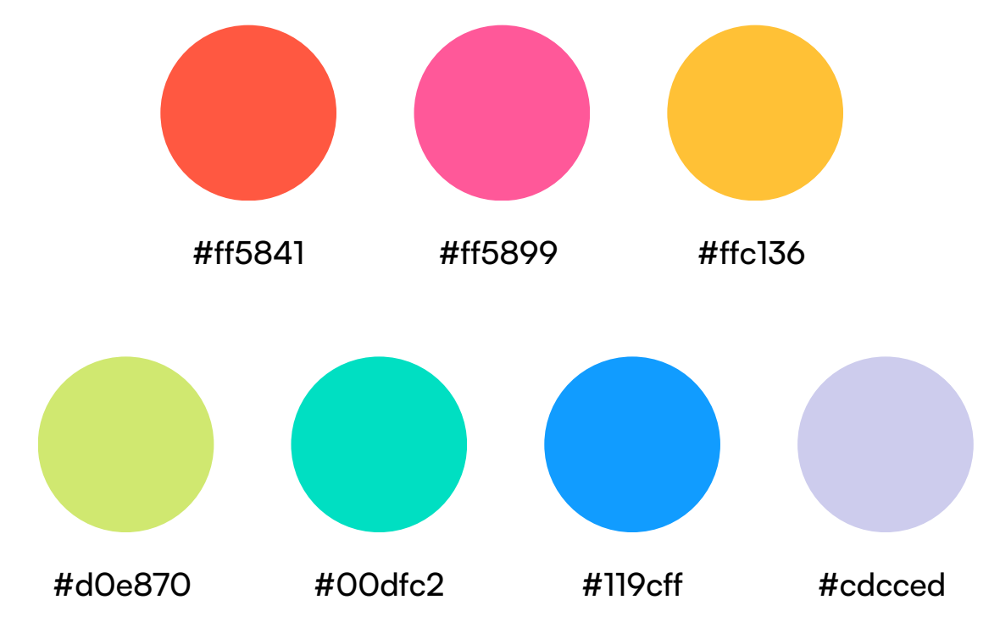

# Identidad visual B89 · Frontend

Esta guía fija el sistema visual del frontend B89 usando la presentación **Formato presentación B89 2026** como fuente de marca. Los gráficos de relleno y el texto de ejemplo de la presentación no se trasladan como contenido de producto.

## Tipografía

La presentación muestra **Satoshi Medium** y **Satoshi Bold** (página 31). Esas dos variantes son la referencia del frontend:

| Variante | Aplicación |
| --- | --- |
| Satoshi Medium | Texto de interfaz, navegación, etiquetas y contenido de lectura. |
| Satoshi Bold | Titulares, jerarquía principal y numerales destacados. |

Se sirven Satoshi Medium y Bold desde los activos del producto usando los archivos originales WOFF2, sin modificarlos. El build incluye la licencia ITF FFL junto a las fuentes. La tipografía se reserva para la aplicación B89; no ofrecerla como recurso descargable ni reutilizarla para dar servicio a otros productos.

La composición de numerales grandes de la página 34 puede usarse para etapas y métricas de contexto: dos dígitos, peso Bold, color de marca y alineación consistente. Los números no sustituyen etiquetas ni estados legibles.

## Paleta oficial

La página 32 define exactamente estos siete colores. La imagen siguiente está recortada de esa página para conservar las muestras originales.

| Nombre de referencia | Hex | RGB |
| --- | --- | --- |
| Coral | `#FF5841` | `255, 88, 65` |
| Fucsia | `#FF5899` | `255, 88, 153` |
| Amarillo | `#FFC136` | `255, 193, 54` |
| Lima | `#D0E870` | `208, 232, 112` |
| Turquesa | `#00DFC2` | `0, 223, 194` |
| Azul | `#119CFF` | `17, 156, 255` |
| Lavanda | `#CDCCED` | `205, 204, 237` |

La presentación entrega la paleta, no significados para severidad o estado. No asignar estos tonos a gravedad de alertas, aprobación, error o salud sin una decisión explícita de producto. Mantener el texto legible sobre las superficies neutras del Dashboard, comprobar contraste y no usar el color como único indicador.

## Logotipo

La página 35 muestra tres versiones del monograma circular. Se recortaron desde el PDF a PNG con transparencia, sin redibujar ni deformar sus formas:

| Variante | Recurso | Uso |
| --- | --- | --- |
| Degradado coral–fucsia–naranja | `assets/logo/b89-mark-gradient.png` | Marca principal en documentación y fondos claros. |
| Blanco sobre negro | `assets/logo/b89-mark-dark.png` | Fondos oscuros. |
| Negro sobre blanco | `assets/logo/b89-mark-light.png` | Fondos claros cuando el degradado no corresponda. |

Conservar proporción, círculo, colores y espacio alrededor. No aplicar filtros, contornos, sombras ni reconstrucciones tipográficas. Para el nombre textual del producto, escribir **B89 SOC** o **B89 SecOps** en texto Satoshi; no componerlo dentro del monograma.

## Mascotas e ilustraciones

La presentación identifica a **Remi**, el conejo (página 37), y **Mundi**, el planeta (página 38). Los PNG siguientes se extrajeron de las páginas de marca y se recortaron a sus límites transparentes; el dibujo interior se conserva sin cambios.

### Remi

  
  
  
  
  

La ilustración de producto de Remi en órbita proviene de la página 10:

### Mundi

  
  

### Ilustraciones B89 de la presentación

La galería conserva los recursos ilustrados de las páginas 36, 39, 40 y 42. Los nombres son identificadores de biblioteca, no significados de estado:

  
  
  
  
  
  
  
  
  
  
  
  
  
  

## Criterios de uso en el SOC

- Mantener la presentación visual B89 en el shell, la navegación, los formularios y las pantallas vacías; el plugin B89 permanece dentro del Dashboard Wazuh.
- Usar Remi y Mundi en bienvenida, ayuda y documentación. No cubrir tablas, alertas densas o controles de aprobación con ilustración decorativa.
- No usar una mascota para comunicar que una amenaza fue contenida, que una aprobación ocurrió o que una fuente está saludable. Esos hechos requieren datos y texto de estado del backend.
- Conservar los colores semánticos existentes de severidad de Wazuh hasta que producto apruebe una escala B89 compatible; la paleta de marca no reemplaza la codificación operativa.
- Mantener `alt` descriptivo, no esconder información importante dentro de una imagen y no recolorear los assets de la galería.
- Esta es la referencia visual del frontend B89. El producto solo usa los recursos gráficos oficiales de B89.

## Procedencia de los recursos

Los assets se extrajeron de **Formato presentación B89 2026.pdf**: logo (página 35), paleta (página 32), Remi (páginas 10 y 37), Mundi (página 38) e ilustraciones (páginas 36, 39, 40 y 42). Se conservaron los PNG embebidos y se eliminó únicamente el margen transparente exterior. El logo y la paleta son recortes rasterizados de alta resolución de sus páginas vectoriales.
