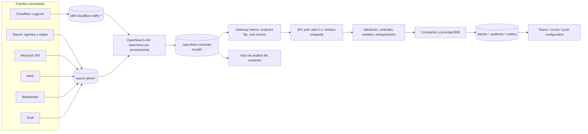

# OpenSearch ML: cobertura y entrega profesional de alertas

Estado: diseño e implementación en código; el estado del despliegue y la evidencia operativa se registrarán tras publicar esta versión (2026-11-22).

## Objetivo y límites

Acortar la demora de una anomalía desde que el evento queda indexado hasta que el SOC muestra
una alerta explicable, cubrir las integraciones que ya aterrizan en el Indexer y conservar una
política de ruido medible. «Inmediato» significa que el sistema consulta resultados en segundos;
la propia detección requiere completar al menos un intervalo de datos y ejecutar el modelo. No se
promete detección en un segundo cuando el detector agrupa ventanas de 1 minuto.

Alcance actual comprobable en el repo: eventos Wazuh (incluidos grupos de actividad AWS,
Cloudflare, Bitdefender y Snyk), actividad Microsoft 365 por suscripción, y tráfico Logpush de
Cloudflare. Se habilitará ML solo donde exista un campo, volumen y granularidad adecuados. La
presencia de un collector no demuestra por sí sola que tenga volumen suficiente para entrenar un
detector; streams con escasa actividad mantienen reglas deterministas y salud de fuente hasta
reunir datos suficientes.

## Diagnóstico y decisiones de diseño

1. El repo tiene nueve detectores versionados (cuatro Cloudflare Logpush y cinco Wazuh/M365);
   los cuatro Logpush usan `window_delay=15m` y casi todos agregan cada 10–15 minutos. El instalador no actualiza los
   existentes salvo `B89_AD_UPDATE=true`.
2. `detections/tools/apply-anomaly-monitors.sh` corría cada diez minutos, consultaba solo tres
   detectores, exigía grado/confianza mayores a 0.7 y creaba triggers sin acciones.
3. La API actual no importa resultados de AD; `docs/07` describe esa integración como propuesta.
   El gateway actual solo expone alertas Wazuh, Cloudflare traffic y salud del clúster.
4. Se mantiene el Indexer detrás del gateway de lectura allowlist. Ni navegador ni API reciben
   DSL arbitrario. La consulta de resultados usa un endpoint fijo, un intervalo corto, un rango
   de tiempo acotado y `search_after`/orden estable.
5. Una anomalía cualificada se incorpora como señal `finding` con identidad determinista del
   resultado, detector y entidad. El motor de promoción/correlación sigue siendo dueño de la
   prioridad; una anomalía aislada crea como máximo una alerta de investigación de baja prioridad,
   y no un incidente ni una acción de respuesta.
6. Los umbrales iniciales son conservadores y versionados: `anomaly_grade >= 0.80` y
   `confidence >= 0.90`; resultados con baja confianza durante el aprendizaje inicial quedan
   fuera del SOC. Los resultados del mismo detector y entidad se agrupan en ventanas de 30 min.
   Una señal que no supera ambos límites queda disponible en el análisis ML,
   no llega a la bandeja de alertas. Se ajustará únicamente con revisión de falsos positivos,
   precisión y latencia por integración.
7. Solo el detector Cloudflare de errores por tres hosts fijos usa buckets de 1 minuto. Los
   detectores por IP (alta cardinalidad), WAF y streams Wazuh/M365 usan 5 minutos. El delay queda
   en 5 minutos hasta medir el percentil alto de llegada; los cuatro detectores Logpush reducen
   su delay anterior de 15 a 5 minutos. No se fija en cero ni por debajo de una demora medida.
8. OpenSearch Alerting no será el segundo sistema de notificación SOC: actualmente no hay acción
   configurada. B89 será el camino único de promoción, deduplicación, auditoría y envío por los
   canales habilitados (Teams, correo, push). OpenSearch conserva la evaluación y el historial ML.

## Arquitectura objetivo



## Secuencia de una anomalía

```mermaid
sequenceDiagram
  participant S as Servicio conectado
  participant I as Indexer
  participant AD as OpenSearch AD
  participant G as Gateway de solo lectura
  participant P as Poller B89
  participant D as Detección y correlación B89
  participant N as Outbox de notificaciones
  S->>I: Indexa evento con hora original
  AD->>I: Lee ventana completa y genera resultado RCF
  AD->>I: Escribe resultado con detector, entidad, grado y confianza
  P->>G: Cada 5 s consulta resultados recientes (ventana solapada)
  G->>I: Consulta fija de resultados, sin DSL del caller
  I-->>G: Resultados ordenados por execution_end_time
  G-->>P: Página acotada
  P->>P: Valida, filtra grado/confianza, calcula ID determinista
  P->>D: Promueve solo si R cumple política y no fue visto
  D->>D: Correlaciona entidad y aplica prioridad con razones
  D->>N: Persiste alerta/outbox de forma idempotente
  N-->>S: Entrega por canales SOC activos; registra aceptación/fallo
```

## Reglas de cobertura por integración

| Integración ya conectada | Datos/índice observados en repo | Señal ML inicial | Granularidad propuesta | Guarda de calidad |
| --- | --- | --- | --- | --- |
| Cloudflare Logpush | `b89-cloudflare-traffic-*` | Errores/rutas de pagos, exportaciones y actividad por IP del backoffice | 1 min para errores de pagos; 5 min para detectores por IP y actividad | Solo hosts/rutas allowlist; requiere datos continuos y entidad IP/host; grado ≥ 0.80 y confianza ≥ 0.90 |
| Microsoft 365 | `wazuh-alerts-*`, grupos `office365`, `data.office365.Subscription` | Fallos de login y descargas SharePoint por usuario | 5 min | Excluir eventos ajenos a esas operaciones; separar suscripciones y usuario |
| AWS | `wazuh-alerts-*`, grupo `aws` | Volumen de hallazgos/eventos AWS por familia | 5 min al reunir densidad | No mezclar con otros proveedores; mantener detecciones Wazuh de cambios críticos |
| Bitdefender | `wazuh-alerts-*`, grupo `bitdefender` | Actividad de endpoint/hallazgos | 5 min al reunir densidad | Las reglas de malware deterministas siguen siendo primarias |
| Snyk | `wazuh-alerts-*`, grupo `snyk` | Cambios/burst de hallazgos por proyecto cuando haya clave estable | 5 min al reunir densidad | No agrupar por campos de alta cardinalidad no validados |
| Wazuh endpoints | `wazuh-alerts-*`, `agent.name`, `rule.level` | Volumen anómalo por agente y nivel alto | 5 min | Nivel mínimo explícito; no sustituye reglas Wazuh |
| Autenticación Wazuh | `wazuh-alerts-*`, identidad de cuenta y eventos de login | Aumento inusual de inicios de sesión por usuario | 5 min | Identidad estable y regla de autenticación; no sustituye reglas Wazuh |

Los detectores por proveedor se activan solo si el campo y el mapeo están verificados y la
frecuencia de eventos permite formar un modelo estable. La API reportará por detector: última
ejecución, atraso, resultados aceptados/rechazados por umbral y fallos de consulta. Un proveedor
sin datos se marca «sin muestra suficiente», no como healthy ni como incidencia ML.

## Metas operativas iniciales

- Poll de resultados: cada 5 s, con timeout de 3 s, página máxima 200 y overlap de 2 min.
- Latencia de entrega B89 tras `execution_end_time`: P95 ≤ 15 s; deduplicación efectiva = 100%.
- Latencia evento→alerta ML: medir por separado (estimación inicial P95 ≤ 7 min para los errores
  por host Cloudflare y ≤ 11 min para streams con bucket de 5 min); depende de ingestión y
  calentamiento del modelo.
- Falso positivo: revisión semanal por integración, porcentaje de alertas ML marcadas benignas,
  supresiones, grado/confianza y reglas de corroboración. No bajar umbrales por conveniencia.
- Backlog/errores: exponer última lectura exitosa, documentos procesados y lag; el pull solapado
  permite recuperarse tras reinicios sin perder resultados.

## Secuencia de implementación

1. Endurecer gateway y permisos con acceso read-only a resultados ML y endpoint fijo.
2. Agregar cliente/normalizador de resultados con cursor temporal solapado, validación de esquema,
   límites estrictos, IDs deterministas y métricas de lag.
3. Conectarlo al `promoteEvent` y al outbox existentes; mantener incidentes/respuestas fuera del
   alcance de una anomalía aislada.
4. Reducir intervalo/delay de detectores continuos y añadir detección por proveedor solo con
   campos reales y densidad suficiente; cambiar en forma versionada e idempotente.
5. Eliminar la brecha del monitor Alerting (sin acciones y cobertura parcial): dejarlo como
   monitor técnico de salud o documentar que B89 es el único notificador operativo.
6. Documentar runbook, política anti-ruido y capacidad/rollback. Tras publicar, comprobar roles
   efectivos, estado de detectores y llegada de un resultado al SOC antes de declarar medidos los
   objetivos de latencia; hasta entonces son metas, no mediciones.

## Evidencia y fuentes técnicas

- OpenSearch recomienda dimensionar intervalo según densidad; intervalos cortos dan rapidez pero
  pueden aumentar ruido/coste, y `window_delay` debe reflejar el límite alto real de ingesta:
  <https://docs.opensearch.org/latest/observing-your-data/ad/index/>.
- La documentación describe la demora de actualización del índice de resultados y el uso de
  `execution_end_time` más un pequeño solapamiento para recuperar resultados recién indexados:
  <https://docs.opensearch.org/latest/observing-your-data/ad/managing-anomalies/>.
- Los monitores pueden generar alertas y ejecutar acciones; el repo actual tiene `actions: []`,
  por eso no hay entrega efectiva desde Alerting:
  <https://docs.opensearch.org/latest/observing-your-data/alerting/monitors/>.
