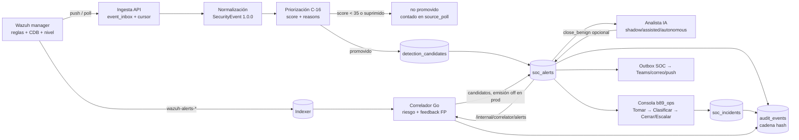

# SOC que aprende de su histórico · Fase 1: diagnóstico

Estado: borrador de solo lectura (2026-11-24, `main` @ 548f395). No se cambió código.
Alcance: qué existe hoy en B89 para que las alertas cerradas como falso positivo (FP) eviten
trabajo repetido, qué falta y qué riesgos hay. Las rutas son relativas a la raíz del repo.

**Conclusión corta:** B89 ya tiene **tres** mecanismos parciales e independientes que aprenden
del veredicto FP: (1) el Analista IA con `close_benign`, (2) el bucle de *feedback* del
correlador Go y (3) las reglas benignas estáticas en la priorización. Ninguno tiene un
fingerprint más fino que «regla + entidades», un motivo de cierre estructurado ni un ciclo
de vida de patrón con validación humana y dueño. La propuesta de Fase 2 debería **unificar y
endurecer** lo existente en vez de agregar un cuarto mecanismo.

---

## 1. Arquitectura y ciclo de vida de una alerta

| Etapa | Dónde | Notas |
|---|---|---|
| Detección | Wazuh (overlay en `wazuh/`, `detections/`, `infra/wazuh/`) | Decide *que* hay alerta. Afinamiento por `if_sid` nivel 0, CDB, `frequency/ignore`. |
| Ingesta | `modules/soc/src/ingestion.ts`, `wazuh-push-inbox.ts`, `apps/api/src/runtime/*` | Cursor con lease/fencing; observaciones por pasada con `duplicates`, `suppressed`, `belowThreshold`. |
| Normalización | `modules/telemetry/src/wazuh-normalization.ts` | Regla (id, nombre, grupos), severidad, categoría, host del agente, usuario, IP origen, extensión M365. |
| Enriquecimiento/priorización | `modules/detection/src/prioritization.ts` (ruleset 1.1.0), `correlation.ts` | Identidad privilegiada/break-glass, activo crítico/expuesto, repetición, correlación por entidad, cadena de compromiso, regla benigna, mantenimiento. |
| Promoción | `modules/detection/src/promotion.ts` | Idempotente por `sha256(tenant, recordId, rulesetVersion)`: dedup **por evento**, no por patrón. |
| Triaje | `modules/soc/src/alert.ts`, `use-cases.ts`, consola `wazuh/dashboard/plugins/b89_ops` | Máquina de estados `new → acknowledged → triaged → escalated/closed`, CAS por `revision`. |
| Triaje automático | `modules/assistant/src/investigations/*`, `apps/api/src/assistant/analyst-actions.ts` | Analista IA; puede cerrar P4 benignas si se habilita (ver §3.1). |
| Cierre | Alerta: `close` (con o sin triaje). Incidente: `resolved → closed` con `closureReason`. | Ver §2. |

---

## 2. Modelo de datos de alertas y casos

### 2.1 `soc_alerts` (`platform/database/prisma/schema.prisma:342`)

`id, tenant_id, candidate_id, event_record_id, title, priority (P1–P4), score, reasons (jsonb:
code/delta/detail), status, assignee_id, verdict, triage_note, incident_id, occurred_at,
created_at, updated_at, revision, entity_keys[] (user:/ip:/host:), entity_refs[] (opacas),
signal, rule_id, related_alert_ids[]`.

- **Veredicto estructurado:** `TRIAGE_VERDICTS = true_positive | false_positive | benign |
  duplicate` (`modules/soc/src/alert.ts:17`). En la consola: «Real», «No es real», «Real pero
  esperada», «Duplicada».
- **Motivo:** solo `triage_note`, texto libre de 10–2000 caracteres. No hay catálogo de motivos,
  ni campo de evidencia, ni «qué dato demuestra la legitimidad».
- **Quién cerró:** no está en la fila. Solo en `audit_events` (`actor_id`, `actor_type`).
  `assignee_id` es quien tenía la alerta, no necesariamente quien cerró.
- **Cierre sin triaje:** `close` desde `acknowledged` se permite con nota ≥ 10 caracteres
  (`alert.ts:200-208`) y deja `verdict = null`. Esas alertas son invisibles para cualquier
  aprendizaje basado en veredicto.
- **Reapertura:** existe (`reopen: closed → acknowledged`), conserva el veredicto anterior.

### 2.2 `detection_candidates` (`schema.prisma:314`)

Mismos datos de priorización + `idempotency_key`, `ruleset_id/version`, `event_uid`. Unicidad
por `(tenant, idempotency_key)`.

### 2.3 `soc_incidents` (`schema.prisma:405`)

`severity, status, owner_id, summary, closed_at, closure_reason (texto)`. La consola antepone
«Conclusión: Falso positivo | Actividad legítima | Amenaza real contenida | Duplicado…» al
texto (`incident_flow.ts:97-108`), pero el backend lo guarda como un solo string.

### 2.4 Lo que **no** llega a la alerta

El `SecurityEvent` canónico (`packages/contracts/src/security-event/generated.ts`) **no se
persiste en Postgres**: la alerta guarda `event_record_id` y el original queda en el Indexer
(`wazuh-alerts-*`) y como `raw.ref` con `sha256`. Además el contrato no tiene campos de
**proceso, línea de comando, hash de archivo, proceso padre, destino/puerto, URL ni MITRE**
(solo `rule.groups`). Un fingerprint como el que pide el objetivo hoy solo puede usar:
`rule_id`, `signal`, `entity_keys` (usuario, IP origen, host), categoría/resultado y, para
M365, la extensión `microsoft.office365`.

---

## 3. Mecanismos que ya existen

### 3.1 Analista IA: cierre benigno automático (TS)

`modules/assistant/src/investigations/{policy,actions,settings}.ts`.

- Historial: cuenta en `soc_alerts` (últimos 30 días) alertas con **misma regla y mismas
  `entity_refs`** (`soc-stores.ts:596`, `policy.ts:210-223`). Solo `false_positive` suma como
  FP; `benign` y `duplicate` no.
- `KNOWN_BENIGN_PATTERN` exige: mismo alcance, 0 TP, 0 abiertas, FP ≥ `minHistory` (def. 5,
  rango 3–50), < 2 fuentes, < 2 tácticas, sin IP maliciosa.
- Guardas duras de cierre (`actions.ts:174-212`): sin inferencia del modelo, resultado
  verificado, solo P3/P4 y además `priority >= closeBenign.maxPriority` (def. `P4`: en la
  práctica **solo P4**), evidencia completa y sin truncar, fuentes sanas, sin incidente.
- Modos `shadow` (por defecto) / `assisted` / `autonomous`; `enabled:false` y
  `actions.closeBenign:false` por defecto, por tenant (`AiAnalystSettings` en DB).
- Ejecución: `acknowledge → triage(false_positive) → close` como `svc:b89-ai-analyst` con nota
  fija «Cierre automático del Analista IA … Expediente <jobId>».
- `stateChangeRequiresReviewNotice: false` (decisión del dueño 2026-11-15): un autocierre no
  avisa a nadie.

### 3.2 Correlador Go: bucle de feedback FP

`services/b89-correlator/internal/feedback/feedback.go`.

- Clave `rule_id + \0 + entidad` (≈ fingerprint actual). FP = `false_positive` o `benign`.
- Política: ≥ 3 FP, ratio ≥ 0,8, ventana 30 d, TTL de supresión 72 h, `AutoSuppress=false`.
- Estados de supresión `none → proposed → active → expired`; propuestas `allowlist` (par),
  `demote` (≥ 3 entidades) y `review` (regla protegida). Regla protegida = alguna vez fue P1 o
  está en `B89_CORRELATOR_PROTECTED_RULES`.
- Genera la lista CDB **propuesta** `b89-correlator-fp-allowlist` (`GET /v1/feedback/allowlist.cdb`)
  que nunca se aplica sola. Audita `risk.feedback.proposed`, `risk.suppression.applied/expired`.
- Efecto: solo anula la contribución de riesgo en el correlador; **no cierra alertas B89**.
- Si el feed de alertas viene truncado, fuerza `AutoSuppress=false`.

### 3.3 Priorización: reglas benignas estáticas

`B89_DETECTION_KNOWN_BENIGN_RULES=ruleId:referencia` (`platform/configuration/src/schema/detection.schema.ts`).
Suprime la **regla entera** (score a 0, `KNOWN_BENIGN`), salvo break-glass y cadena de
compromiso. `maintenanceWindow` existe en el dominio pero **no se cablea** en `bootstrap.ts`
(no hay fuente de ventanas de cambio).

### 3.4 Wazuh (overlay)

- Política escrita: `docs/detection-engineering/07-ajuste-falsos-positivos.md` («degradar, no
  silenciar», allowlists CDB por PR con aprobación del SOC Lead, fixture TP + fixture FP por
  cambio, revisión mensual, bitácora de cambios).
- CDB en `detections/lists/` (`b89-admin-accounts`, `b89-service-accounts`,
  `b89-authorized-scanners`, `b89-critical-zones`, …) con formato `clave:motivo`.
- Silenciado nivel 0 por `if_sid` + lista (p. ej. `detections/linux/noise-tuning/rule.xml`
  101765–101767), dedup por `frequency/timeframe/ignore`.
- Metadatos por caso de uso (`detections/<src>/<caso>/metadata.yaml`): `mitre`, `severity`,
  `false_positives`, `tuning`, `owner`. `catalog.yaml` no tiene campo de supresión ni de
  «nunca suprimir».

### 3.5 Otros

| Mecanismo | Dónde | Estado |
|---|---|---|
| Cierre masivo de FP por regla | `detections/tools/close-false-positives.mjs` | Manual, dry-run por defecto, filtra solo por `ruleId` (+ texto). |
| Dedup de promoción | `promotion.ts` | Por evento; dos eventos iguales = dos alertas. |
| Agrupación por entidad | `correlation.ts` (24 h), correlador (`grouping.go`, 4 h/24 h) | Solo `related_alert_ids` (foto); no hay caso con contador primera/última vez. |
| Notificaciones | `modules/soar/src/notification-digest.ts` | Las suprimidas y P3/P4 van a resumen, no a aviso inmediato. |
| Conocimiento por regla | `apps/api/src/assistant/soc-knowledge.generated.ts` | FP conocidos y «cuándo escalar» en texto estático (55 casos), MITRE por caso. |
| Auditoría | `platform/audit/src`, `audit_events` | Append-only real: cadena sha256 por tenant + triggers que bloquean UPDATE/DELETE/TRUNCATE. |
| Métricas | `docs/detection-engineering/03-modelo-operativo.md`, correlador `/metrics`, `internal/evaluation` | Definidas (MTTD/MTTA/MTTR, fidelidad, ruido). Dashboard «Calidad de detección» solo muestra volumen, no veredictos. |
| Reputación IOC | `infra/wazuh/network/threat-intel/b89_threat_intel.py` | Listas CDB diarias (Spamhaus, Feodo, Tor, atacantes WAF). Sin consulta por API (VT/AbuseIPDB). |

---

## 4. Brechas frente al objetivo

| # | Requisito del objetivo | Hoy | Brecha |
|---|---|---|---|
| B1 | Motivo de cierre estructurado (`FP_ACTIVIDAD_LEGITIMA_CONOCIDA`, …) | `verdict` de 4 valores + nota libre | Falta catálogo de motivos, justificación estructurada, referencia de evidencia; cierre sin triaje deja `verdict=null`; incidente solo con texto. |
| B2 | Fingerprint con normalización de campos variables | Regla + entidades (IA y correlador, cada uno a su manera) | Sin función única ni versionada; el evento canónico no trae proceso/comando/hash/destino; no se persiste. |
| B3 | Dedup/agrupación en un caso con contador | Una alerta por evento; `related_alert_ids` fijo | Falta agrupación por fingerprint con `count`, `first_seen`, `last_seen`. |
| B4 | Almacén de patrones FP con dueño y expiración | Estado de supresión en memoria del correlador; settings del analista | No hay tabla de patrones, ni `owner`, ni validación humana, ni casos de origen persistidos. |
| B5 | Motor de decisión con registro explicable | IA: `deterministic.reasons` + `AiInvestigationAction` | Solo cerrar/no cerrar; no «bajar severidad» ni «agrupar»; dos motores (IA y correlador) con umbrales distintos (5 vs 3, FP vs FP+benigno). |
| B6 | Salvaguardas configurables | Duras en código (P3/P4, break-glass, cadenas, regla P1 protegida) | Sin exclusión por táctica MITRE (la alerta no trae táctica; `signal` no cubre movimiento lateral ni impacto); sin lista «nunca suprimir» por regla en el catálogo; sin rate-limit por patrón; sin muestreo de calidad; activos críticos y ventanas de cambio prácticamente vacíos. |
| B7 | Detección de deriva | Igualdad exacta de `entity_refs` | No compara hash, proceso, destino ni IOC nuevo (no existen en la alerta). |
| B8 | Kill switch global y por regla | `B89_ANALYST_ENABLED`, `settings.mode`, `actions.closeBenign`, `AUTO_SUPPRESS` | No hay kill switch por regla ni uno único para «autogestión por patrones». |
| B9 | Sombra con reporte comparativo | Modo `shadow` de la IA registra lo que haría | No hay reporte «decisión del sistema vs analista» (no se registra el desacuerdo humano). |
| B10 | Reversión | `reopen` por alerta | No hay revocar patrón + reabrir afectadas; los autocierres no se distinguen en `soc_alerts` sin cruzar auditoría. |
| B11 | Asistente de tuning | Propuestas CDB del correlador | No genera solicitud de aprobación ni evidencia estadística por regla+activo+usuario. |
| B12 | Métricas de precisión | Ninguna sobre veredictos | Falta tasa FP por regla, % autocerrado, % revertido, horas ahorradas. |

---

## 5. Calidad del histórico

- **Motivos:** el veredicto es estructurado (4 valores); el *porqué* es texto libre. Los
  autocierres de la IA y los cierres masivos del script usan notas fijas, distinguibles por
  `actor_id` en auditoría.
- **Volumen:** `docs/18:303` estima «decenas a cientos de alertas por día», dominado por ruido
  de Internet contra la consola. No hay cifra medida en el repo.
- **Corpus etiquetado:** `docs/29:76-106` y la sección «Medición» de
  `docs/detection-engineering/07` afirman que **no existe un corpus adjudicado**. En el repo no
  hay exportación histórica ni seeds de alertas; los `fixtures.jsonl` de detecciones (≈ 2 330
  líneas) son logs sintéticos sin etiqueta de analista.
- **Retención:** `soc_alerts` sin purga en código (no verificado en despliegue); Indexer 90 d
  hot/warm según ISM actual, snapshots hasta 400 d (requieren restaurar). El backtesting sobre
  campos ricos (proceso, comando) dependería del Indexer, no de Postgres.
- **Sesgos conocidos:** cierres manuales masivos por regla (`close-false-positives.mjs`) y
  autocierres IA marcan `false_positive` sin revisión por alerta; si se usan como verdad
  terreno, inflan el «historial benigno».
- **Para backtesting real** necesito una consulta a la base del ambiente (ver preguntas). Sin
  eso, la Fase 4 solo podría hacerse con datos sintéticos, y lo diré así.

---

## 6. Riesgos detectados

| Riesgo | Detalle | Severidad |
|---|---|---|
| R1 Autorrefuerzo | `alertStats` no filtra por actor: los autocierres de `svc:b89-ai-analyst` (y del script masivo) cuentan como FP para el siguiente `KNOWN_BENIGN_PATTERN`. Un patrón puede sostenerse solo. | Alta |
| R2 Fingerprint grueso | «Misma regla + mismo usuario/IP/host» no distingue otro hash, otro comando u otro destino: un atacante que reutiliza una cuenta o host con historial FP hereda el patrón. | Alta |
| R3 Autocierre silencioso | `stateChangeRequiresReviewNotice:false` y sin muestreo: un error de patrón no se descubre. | Media |
| R4 Dos motores divergentes | IA (≥ 5 FP, solo `false_positive`) y correlador (≥ 3 FP, FP+`benign`, ratio 0,8) pueden discrepar; ninguno es la fuente de verdad. | Media |
| R5 Supresión de regla completa | `B89_DETECTION_KNOWN_BENIGN_RULES` apaga la regla para todas las entidades (contra el principio «nunca toda la regla»). | Media |
| R6 Contexto vacío | Activos críticos y privilegiados vienen de env (máx. 500); la lista de criticidad del correlador solo tiene `trusted`; sin CMDB ni calendario de cambios. Las salvaguardas por activo crítico no protegen nada si la lista está vacía. | Media |
| R7 Táctica MITRE ausente en la alerta | La exclusión por táctica de alto impacto no se puede evaluar en tiempo de decisión sin enriquecer desde `metadata.yaml`/conocimiento. | Media |
| R8 IDs de regla repetidos | `COORDINACION` reporta IDs 1018xx repetidos entre fuentes: un fingerprint por `rule_id` sin fuente colisiona. | Media |
| R9 Cierre sin veredicto | Cierres desde `acknowledged` pierden la etiqueta y sesgan métricas. | Baja |
| R10 Volumen bajo | Con decenas–cientos de alertas/día y sin corpus, N mínimos de 3–5 se alcanzan rápido en reglas ruidosas pero la precisión no es medible todavía; ML (módulo K) no está justificado. | Baja |

---

## 7. Preguntas abiertas

1. **Unificación:** ¿el nuevo motor debe **reemplazar** el `close_benign` del Analista IA y el
   feedback del correlador como única fuente de verdad (mi recomendación), o convivir con ellos?
2. **Estado real en producción:** ¿qué tenant tiene hoy el Analista IA en `autonomous` con
   `closeBenign` activo, y `B89_CORRELATOR_AUTO_SUPPRESS`/`EMIT` en qué valor? ¿Hay autocierres
   ya hechos?
3. **Histórico para backtesting:** ¿puedo obtener (o me pasas) un volcado anonimizado de
   `soc_alerts` + `audit_events` `soc.alert.*` del ambiente AWS demo/productivo? ¿Cuántos meses
   hay?
4. **Campos ricos:** ¿acepto extender el contrato `SecurityEvent` (versión 1.1.0) con un bloque
   opcional `process` / `file.hash` / `destination` / `mitre`, o el fingerprint debe vivir solo
   con lo que ya llega (regla, entidades, categoría)?
5. **Validación humana:** ¿qué rol aprueba que un patrón pase a `activo`: el líder SOC
   (`soc-lead`), con SoD (quien propone no aprueba)? ¿Duración máxima de un patrón (propongo 30
   d, renovable)?
6. **Catálogo de motivos:** ¿mantenemos `verdict` (4 valores) y agregamos `closure_reason` como
   subcódigo, o lo sustituimos? ¿Motivos adicionales que necesiten (p. ej.
   `FP_DATOS_INCOMPLETOS`, `TP_RIESGO_ACEPTADO`)?
7. **Severidad permitida:** el objetivo excluye alta/crítica del autocierre. Hoy la IA solo
   cierra P4. ¿El techo es P4, o se permite P3 sin agravantes?
8. **Contexto de negocio:** ¿existe un inventario de activos críticos / cuentas privilegiadas /
   calendario de cambios fuera del repo que pueda conectar, o lo mantenemos en las listas CDB y
   variables actuales?
9. **Autocierre silencioso:** ¿se mantiene la decisión del 2026-11-15 de no avisar, o el
   muestreo del 10 % y el aviso por pausa de patrón sustituyen esa decisión?
10. **Coordinación:** ¿Codex tiene a su cargo la consola (clasificación/cierre)? Lo registraré
    en `COORDINACION-CLAUDE-CODEX.md` antes de tocar contratos de la UI en la Fase 3.
