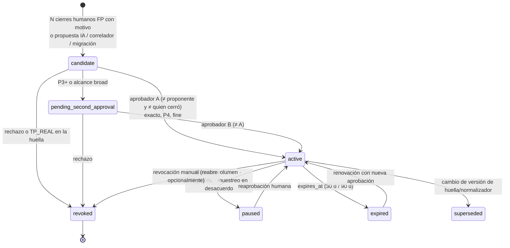

# SOC que aprende de su histórico · Fase 2: diseño

Estado: **propuesta para aprobación** (2026-11-24, `main` @ 548f395). No hay código.
Base: [00-diagnostico.md](00-diagnostico.md) y las decisiones del dueño del 2026-11-24.
Nombre interno del componente: **Motor de aprendizaje SOC** (`@b89/soc-learning`).

> **Ajustes al implementar la etapa A (2026-11-24):** `FP_ACTIVIDAD_LEGITIMA_CONOCIDA` admite
> los veredictos `false_positive` y `benign`, porque la consola y el Analista IA ya usan
> `false_positive` para ese caso. Los cierres históricos humanos quedan con `closure_reason` NULL
> en vez de un código `LEGACY_SIN_MOTIVO`, para no ampliar el catálogo con un valor que nadie
> puede elegir. Se agregó el origen `service_other` para identidades `svc:` desconocidas.

## 0. Decisiones recibidas y supuestos

### 0.1 Decisiones del dueño (vinculantes)

| # | Decisión |
|---|---|
| D1 | El motor es el **único** punto de decisión y la única fuente de verdad de patrones. El Analista IA y el correlador pasan a *proponer*. Las reglas benignas fijas se migran a patrones granulares; nada se borra sin aprobación. |
| D2 | Backtesting con volcado que extrae y anonimiza el dueño (HMAC, clave fuera del repo). El motor no pasa de sombra a activo sin 2–4 semanas reales en sombra. Gold set de 200–300 alertas etiquetadas a mano. |
| D3 | Extensión del evento solo aditiva y versionada. Línea de comando normalizada + hash del original, con secretos redactados. Sin esos campos la huella es **gruesa** y nunca autocierra. |
| D4 | Regla de dos personas; IA y scripts nunca aprueban. Caducidad 30 d en la primera activación y 90 d al renovar; renovar exige nueva aprobación. |
| D5 | El contador de FP solo cuenta cierres humanos, con motivo estructurado, sobre alertas distintas y en M días distintos. Se agrega `origen_cierre`. |
| D6 | No se avisa por cada autocierre. A cambio: resumen diario, muestreo del 10 % y reporte semanal de precisión. |
| D7 | Fail-closed: sin contexto de negocio poblado, el motor solo agrupa o baja prioridad. |
| D8 | Toda clave de regla es `fuente:rule_id`. |

### 0.2 Supuestos conservadores (preguntas sin respuesta)

| Pregunta | Supuesto adoptado |
|---|---|
| #2 Estado real en producción | Desconocido. Se trata como si el Analista IA pudiera estar en `autonomous`. Todo cierre hecho por `svc:*` cuenta como **no humano**. La etapa 0 incluye una consulta de solo lectura que corre el dueño para confirmarlo. |
| #6 Catálogo de motivos | Se **conserva** `verdict` (4 valores, la consola y la IA dependen de él) y se agrega `closure_reason` como subcódigo obligatorio, con un mapeo fijo motivo→veredicto (§3.1). Se suman dos motivos: `FP_DATOS_ERRONEOS` y `TP_RIESGO_ACEPTADO`. |
| #7 Techo de severidad | Autocierre **solo P4** con severidad normalizada `low` o `informational`. P3 como máximo baja prioridad o se agrupa. P1/P2 solo se agrupan y siguen visibles. |
| #8 Inventario externo | No existe. Las listas de contexto se gestionan en B89 (tabla nueva, API con auditoría). Las listas CDB y variables actuales sirven de semilla. |
| #9 Aviso de autocierres | Resuelto por D6. |
| #10 Dueño de la UI | La consola (`wazuh/dashboard/plugins/b89_ops`) es de Codex. El backend publica primero los contratos y los registra en `COORDINACION-CLAUDE-CODEX.md`. No se toca la UI sin ese registro. |
| Aprobadores A/B | Los nombres quedaron como marcador. Se crea la capacidad `learning.patterns.approve`, que se otorga **por persona** (no por rol completo) a los aprobadores designados. Por defecto la tiene `b89.soc.lead`. El aprobador B es un segundo titular distinto del A. **Necesito los nombres antes de la etapa D**; no bloquea el diseño. |

---

## 1. Arquitectura propuesta

Principios:

1. **El motor nunca impide que nazca una alerta.** Siempre existe la fila en `soc_alerts`. El motor actúa después: cierra, baja prioridad, agrupa o marca para revisión humana. Así toda acción es reversible, visible y auditable. Dejar de *generar* la alerta solo pasa por afinamiento en Wazuh (el asistente de tuning, §I), por PR y con aprobación.
2. **Decisión pura, efectos aparte.** `decide(alerta, huella, patrones, contexto, config) → Decisión` es una función pura y determinista. Un worker con lease y fencing aplica los efectos usando los comandos normales del dominio (`acknowledge → triage → close`), sin atajos.
3. **Si algo falla, la alerta queda como estaba**, en la cola humana.

```mermaid
flowchart TB
  subgraph Ingesta existente
    W[Wazuh / Indexer] --> N[Normalización<br/>mapping 1.4.0 + ext. b89.observables]
    N --> P[Priorización C-16]
    P --> C[(detection_candidates)]
    C --> A[(soc_alerts)]
  end

  N -. observables .-> FP[Huella v1<br/>función pura]
  FP --> AF[(soc_alert_fingerprints)]
  A -->|outbox: alerta creada| WK[Worker del motor<br/>lease + fencing]

  subgraph Motor de aprendizaje SOC
    WK --> DEC[decide<br/>función pura]
    PS[(learning_patterns)] --> DEC
    CTX[(soc_context_entries<br/>activos, cuentas, ventanas)] --> DEC
    CFG[(soc_learning_settings<br/>CAS + kill switch)] --> DEC
    DEC --> LOG[(learning_decisions<br/>append-only)]
    DEC -->|modo activo| EFF[Efectos vía comandos de dominio<br/>actor svc:b89-soc-learning]
    EFF --> A
    DEC --> GRP[(soc_alert_groups)]
    DEC --> SMP[(learning_reviews<br/>muestreo 10 %)]
  end

  subgraph Proponentes, nunca deciden
    H[Cierres humanos<br/>con motivo estructurado] --> CAND[Generador de candidatos]
    AI[Analista IA] -->|propuesta| CAND
    COR[Correlador Go feedback.go] -->|propuesta gruesa| CAND
    KB[B89_DETECTION_KNOWN_BENIGN_RULES] -->|migración| CAND
  end
  CAND --> PS
  APR[Aprobación A / A+B<br/>learning.patterns.approve] --> PS

  LOG & EFF & APR --> AUD[(audit_events<br/>cadena hash)]
  LOG --> REP[Digest diario · reporte semanal<br/>sombra vs analista · tuning]
```

**Encaje con lo existente**

| Pieza existente | Rol nuevo |
|---|---|
| `modules/detection` | Sin cambios de comportamiento. Aporta el `SecurityEvent` para la huella en el momento de promover. |
| `modules/soc` (`alert.ts`, `use-cases.ts`) | Cierre con motivo estructurado y `closure_origin`. Nuevos eventos de dominio. |
| Nuevo `modules/soc-learning` | Huella, normalización, ciclo de vida de patrones, `decide`, salvaguardas y reportes. Todo puro, con puertos para los stores. Sigue el patrón de `modules/assistant/src/investigations`. |
| `platform/database` | Migraciones aditivas y stores Prisma. |
| `platform/audit` | Toda acción del motor y toda aprobación quedan en `audit_events`. |
| Outbox SOC | Dispara el worker. En la etapa E se verifica el tipo de mensaje exacto de «alerta creada»; si no existe, se agrega uno aditivo. |
| `modules/soar` digest | Digest diario de autocierres y aviso inmediato cuando un patrón se pausa. |
| `services/b89-reports` | Reportes semanal y de tuning (PDF/XLSX/CSV). |

---

## 2. Modelo de datos

Todas las migraciones son **aditivas**: columnas nulas o con valor por defecto y tablas nuevas. No se borran ni se reescriben datos. Nombres: `prisma/migrations/2026MMDDhhmmss_soc_learning_<tema>`. Las tablas de registro llevan triggers `no_update/no_delete/no_truncate`, iguales a los de `audit_events` (migración `20261008120000`).

### 2.1 Cierre estructurado (etapa A)

**`soc_alerts` (columnas nuevas, nulas)**

| Columna | Tipo | Uso |
|---|---|---|
| `closure_reason` | text | Código del catálogo (§3.1). |
| `closure_origin` | text | `human`, `ai_analyst`, `bulk_script`, `learning_engine`, `legacy_unknown`. |
| `closed_by` | text | Actor del último cierre (copia de la auditoría para consultar sin join). |
| `closed_at` | timestamptz | Fecha del último cierre. |
| `rule_key` | text | `fuente:rule_id` (§4.1). Índice `(tenant_id, rule_key, created_at)`. |
| `group_id` | uuid | FK a `soc_alert_groups`. |

**`soc_alert_closures` (nueva, append-only)**

Una fila por cada cierre y por cada reapertura, para que la historia sobreviva a un `reopen`. Columnas: `id, tenant_id, alert_id, kind (close|reopen), verdict, closure_reason, origin, actor_id, actor_type, justification jsonb, evidence_refs jsonb, decision_group_id, correlation_id, at`.

- `justification`: `{ evidenceType, statement (20–2000 caracteres), legitimacyField?, legitimacyValue? }`.
- `evidenceType`: `change_ticket | owner_confirmation | signed_known_binary | documented_service_account | vendor_documentation | log_correlation | scheduled_job | other`.
- `evidence_refs`: hasta 10 de `{ kind: ticket|url|alert|incident|attachment, ref }`. Los adjuntos se reutilizan del almacén de evidencias de incidentes si aplica.
- `decision_group_id`: el cierre en bloque de un grupo comparte este id y **cuenta como una sola confirmación** (§5.2).

**`soc_incidents`**: columna nueva `closure_conclusion` text, con enum `threat_contained | false_positive | legitimate_activity | duplicate`. `closure_reason` sigue siendo texto.

### 2.2 Huella (etapa B)

**`soc_alert_fingerprints`**: `alert_id PK/FK, tenant_id, rule_key, fingerprint, level (fine|coarse), version, components jsonb, computed_at`.

- `components` guarda los valores **normalizados y redactados** (§4). Sirve para explicar la deriva y para recalcular.
- Índices: `(tenant_id, fingerprint, computed_at)` y `(tenant_id, rule_key, level)`.

### 2.3 Agrupación (etapa C)

**`soc_alert_groups`**: `id, tenant_id, fingerprint, rule_key, level, status (open|closed), first_seen_at, last_seen_at, alert_count, primary_alert_id, highest_priority, window_ends_at, revision`.

### 2.4 Patrones (etapa D)

**`learning_patterns`**

| Columna | Tipo | Uso |
|---|---|---|
| `id` | uuid | |
| `tenant_id` | text | |
| `rule_key` | text | |
| `fingerprint` | text | |
| `fingerprint_version` | text | |
| `level` | text | `fine` o `coarse`. |
| `scope` | jsonb | Componentes exactos, o generalizaciones aprobadas, p. ej. `dst.ip ∈ 10.20.0.0/24`. |
| `scope_breadth` | text | `exact` o `broad`. |
| `max_action` | text | `auto_close`, `demote` o `group`. |
| `closure_reason` | text | |
| `status` | text | `candidate`, `pending_second_approval`, `active`, `paused`, `expired`, `revoked`, `superseded`. |
| `source` | text | `human_closures`, `ai_analyst`, `correlator`, `legacy_benign_rule`, `manual`. |
| `owner_id` | text | |
| `proposed_by` | text | |
| `origin_alert_ids` | uuid[] | Hasta 50. |
| `evidence` | jsonb | |
| `confirmations` | int | Decisiones humanas distintas. |
| `distinct_alerts` | int | |
| `distinct_days` | int | |
| `distinct_analysts` | int | |
| `true_positive_seen` | int | |
| `priority_ceiling` | text | Prioridad más alta vista en la evidencia. |
| `baseline_hourly_p95`, `baseline_daily_max` | numeric | Línea base para el límite de volumen. |
| `created_at`, `activated_at`, `expires_at`, `renewal_count` | | |
| `revision` | int | CAS. |

- Índice único parcial `(tenant_id, rule_key, fingerprint) WHERE status IN ('active','paused','pending_second_approval')`.
- `expires_at` es **obligatorio** cuando `status='active'` (CHECK).

**`learning_pattern_approvals`** (append-only): `id, pattern_id, tenant_id, stage (1|2|renewal|revocation), approver_id, decision (approve|reject), comment, at`.

**`learning_pattern_events`** (append-only): transiciones de estado con motivo, por ejemplo `RATE_LIMIT_PAUSE`, `EXPIRED` o `REVOKED_BY_REVIEW`.

### 2.5 Decisiones y revisión (etapas E–H)

**`learning_decisions`** (append-only): `id, tenant_id, alert_id, mode (shadow|dry_run|active), engine_version, config_revision, fingerprint, level, pattern_id, proposed_action, applied_action, confidence (high|medium|low), checks jsonb, drift jsonb, context_snapshot jsonb, sampled bool, at`.

- `checks` lista **cada** salvaguarda evaluada con resultado y detalle. Es el registro explicable.

**`learning_reversals`** (append-only): `id, decision_id, alert_id, pattern_id, actor_id, reason, reopened bool, at`.

**`learning_reviews`**: muestreo y propuestas en dry-run. Columnas: `id, tenant_id, decision_id, kind (quality_sample|dry_run_approval), status (pending|agreed|disagreed|expired), reviewer_id, outcome_reason, at, resolved_at`.

**`learning_gold_labels`**: `id, tenant_id, alert_ref (id o seudónimo), label (fp|tp|benign), labeler_id, round, at`. Admite dos etiquetadores por alerta.

### 2.6 Contexto y configuración

**`soc_context_entries`**: `id, tenant_id, kind (critical_asset|privileged_identity|break_glass|internet_facing|change_window|never_suppress_rule), value, attributes jsonb (p. ej. desde/hasta y activos de una ventana), reason, owner_id, expires_at, revision, created_by, created_at`. Se gestiona por API con auditoría y se une a las listas que ya vienen por variables de entorno (unión, nunca reemplazo).

**`soc_learning_settings`**: documento por tenant con CAS, validado en forma cerrada, igual que `AiAnalystSettings` (§6).

---

## 3. Estandarización del cierre

### 3.1 Catálogo de motivos

| `closure_reason` | `verdict` | ¿Alimenta patrones? | Notas |
|---|---|---|---|
| `FP_ACTIVIDAD_LEGITIMA_CONOCIDA` | `false_positive` o `benign` | **Sí** | Exige `evidenceType ≠ other` y `legitimacyField`. |
| `FP_REGLA_MAL_AFINADA` | `false_positive` | **Sí** | Además alimenta el asistente de tuning. |
| `FP_DATOS_ERRONEOS` | `false_positive` | No | Problema de parser o fuente: se deriva a ingeniería y no se aprende. |
| `TP_BENIGNO_PRUEBA_O_PENTEST` | `benign` | **Nunca** | Un pentest imita ataques. Exige referencia a la ventana o ticket del pentest. |
| `TP_RIESGO_ACEPTADO` | `benign` | **Nunca** | Exige referencia a la aceptación de riesgo con fecha de caducidad. |
| `DUPLICADA` | `duplicate` | No | Exige `evidence_refs` con la alerta o incidente original. |
| `TP_REAL` | `true_positive` | En contra | Invalida candidatos y patrones de la misma huella (§5.3). |

### 3.2 Reglas de validación (dominio, `alert.ts`)

- `close` exige `closure_reason` y `justification` válidos, y el veredicto tiene que coincidir con el motivo según la tabla.
- Cerrar sin triaje previo solo se permite con `DUPLICADA`, para no perder la etiqueta.
- Bandera `B89_SOC_CLOSURE_REASON_REQUIRED`:
  - `false` en la transición: acepta el payload viejo y lo registra como `legacy_unknown`, que no cuenta.
  - Pasa a `true` cuando Codex publique la UI.
- `closure_origin` lo fija el backend **según el actor autenticado**, nunca el cliente:
  - sesión humana → `human`
  - `svc:b89-ai-analyst` → `ai_analyst`
  - `svc:b89-detection-engineering` → `bulk_script`
  - `svc:b89-soc-learning` → `learning_engine`

### 3.3 Etiquetado retroactivo del histórico

Un script idempotente de solo escritura aditiva rellena `closure_origin`, `closed_by` y `closed_at` y crea filas en `soc_alert_closures`. Lee los `audit_events` con `action='soc.alert.close'`:

| Señal en la auditoría | `closure_origin` |
|---|---|
| `actor_id='svc:b89-ai-analyst'` | `ai_analyst` |
| `actor_id='svc:b89-detection-engineering'` o `correlation_id` que empieza con `close-fp-` | `bulk_script` |
| `actor_type='user'` | `human` con `closure_reason` NULL (sin motivo estructurado) |
| Sin auditoría | `legacy_unknown` |

- **Ningún cierre histórico cuenta para candidatos**, ni siquiera los humanos, porque no tienen motivo estructurado.
- El asistente de tuning los muestra agrupados por huella y un analista puede **reconfirmarlos**: una acción humana que agrega una fila nueva de cierre con motivo, sin cambiar la antigua. Solo así entran al contador, y la fecha que cuenta es la del cierre original.
- `alertStats` (`soc-stores.ts:596`) se mantiene para el Analista IA, pero recibe un filtro opcional `origin` y por defecto cuenta **solo** `human`. Eso corta el autorrefuerzo ya desde la etapa A.

---

## 4. Especificación de la huella (v1)

### 4.1 Clave de regla

`rule_key = <fuente>:<rule_id>`

- `fuente` sale de `detections/catalog.yaml#id_ranges` según el rango del ID (`ad`, `cloudflare`, `dlp`, `m365`, …).
- Si el rango no está catalogado, se usa el producto del primer salto `origin` de `provenance` en minúsculas y con guiones. Si tampoco hay, `wazuh`.
- Las reglas del correlador usan `b89-correlator:<pattern_id>`.
- La huella incluye además `rule_name_norm`: si una regla cambia de significado manteniendo el ID, la huella cambia y el patrón deja de aplicar.

### 4.2 Extensión del evento: `b89.observables` v1

Se usa el mismo patrón que `microsoft.office365`: un **namespace dentro de `extensions`**, con contrato 1.0.0 intacto y mapping `wazuh.alerts` 1.4.0. El contenido se valida con un JSON Schema propio. Ningún consumidor actual lee esa clave, así que no se rompe nada.

```jsonc
"extensions": { "b89.observables": {
  "v": 1,
  "agentId": "017",
  "process":  { "image": "c:\\windows\\system32\\svchost.exe", "cmdlineNorm": "...", "cmdlineHmac": "h1_…", "sha256": "…" },
  "parent":   { "image": "…" },
  "file":     { "path": "…", "sha256": "…" },
  "destination": { "ip": "…", "port": 443, "domain": "api.example.com" },
  "mitre": [{ "technique": "T1558.003", "tactic": "credential-access", "from": "rule|catalog" }]
}}
```

**Origen de cada campo en Wazuh** (solo si está presente; nunca se inventa):

| Campo | Fuente en Wazuh |
|---|---|
| `process` | `data.win.eventdata.{image,commandLine,hashes}`, `data.audit.{exe,execve}`, campos de Bitdefender/DLP según su decoder |
| `parent` | `data.win.eventdata.parentImage` |
| `file` | `syscheck.{path,sha256_after}`, `data.win.eventdata.targetFilename` |
| `destination` | `data.{dstip,dstport}`, `data.win.eventdata.{destinationIp,destinationPort,destinationHostname}`, Cloudflare `ClientRequestHost` |
| `mitre` | `rule.mitre.{id,tactic}`; si falta, el `metadata.yaml` del caso de uso, con un mapa generado igual que `soc-knowledge` |

### 4.3 Normalización (función pura `normalizeObservables`)

| Valor variable | Tratamiento |
|---|---|
| Timestamps (ISO, epoch de 10/13 dígitos, `yyyymmdd_hhmmss`) | `{TS}` |
| PID, TID, record id, event uid, sequence | Se **excluyen** de la huella. |
| GUID/UUID (`{…}` o sin llaves) | `{GUID}` |
| Hex de 16 o más caracteres que no es un hash del campo `sha256` | `{HEX}` |
| Rutas temporales (`%TEMP%`, `\AppData\Local\Temp\…`, `/tmp/…`, `/var/tmp/…`) | Directorio a `{TMP}`; se conserva el nombre del archivo, con sus dígitos pasados a `{N}`. |
| Perfil de usuario en la ruta (`C:\Users\<x>\`, `/home/<x>/`) | `{HOME}`. El usuario ya entra por separado. |
| Puertos efímeros (≥ 49152) y puerto de origen | Se excluyen. Los puertos de destino < 49152 se conservan. |
| Mayúsculas | Rutas e imágenes de Windows en minúsculas; dominios en minúsculas y sin punto final; UPN en minúsculas. |
| Espacios y comillas en la línea de comando | Espacios colapsados; comillas redundantes fuera. Se mantiene el orden de los argumentos. |
| **Secretos** | `password=`, `-p <x>`, `--token`, `Authorization: Bearer`, JWT (`eyJ…`), `AKIA…`, cadenas de conexión con `pwd=`, base64 de 40 o más en `-enc`/`-EncodedCommand` → `{REDACTED}`. Se redacta **antes** de persistir y antes del HMAC de la normalizada. |
| Línea de comando original | Nunca se guarda. Solo `cmdlineHmac = HMAC-SHA256(clave del tenant, original)`. Es un HMAC y no un SHA-256 simple para que no se pueda adivinar por fuerza bruta un secreto corto. La clave vive en el gestor de secretos: `B89_LEARNING_FINGERPRINT_KEY_REF`. |

La normalización tiene una versión propia (`normalizerVersion`) y cada regla se prueba con fixtures. Si cambia la versión, cambia la huella: los patrones de la versión anterior pasan a `superseded` y hay que volver a validarlos. Nunca se migran en silencio.

### 4.4 Componentes y nivel

| Grupo | Componentes |
|---|---|
| Regla | `rule_key`, `rule_name_norm` |
| Sujeto | `user` (principal), `host` (preferente `agentId`, si no hostname), `src_ip` solo si la regla es de autenticación o de red y no hay usuario |
| Comportamiento | `process.image`, `parent.image`, `process.cmdlineNorm`, `process.sha256` o `file.sha256`, `file.path` (normalizada), `destination.domain` o, si falta, `destination.ip`, `destination.port` |
| Contexto de origen | `extensions` específicas permitidas por perfil, p. ej. la operación de M365 |

- **Nivel `fine`**: regla, al menos un sujeto y **al menos un** componente de comportamiento.
- **Nivel `coarse`**: cualquier otro caso. Un patrón grueso tiene `max_action ≤ demote` **por construcción**, porque es una restricción en la base de datos y no solo en el código.

### 4.5 Cálculo y colisiones

```
fingerprint = "fp1_" + hex(SHA-256(canonicalJSON({
  v: 1, normalizer: "<normalizerVersion>", tenant, level,
  components: { <nombre>: <valor normalizado> | null }   // claves ordenadas, null explícito
})))
```

- JSON canónico con claves ordenadas, igual que `platform/audit`. Evita ambigüedad de separadores (`"a","bc"` ≠ `"ab","c"`) y distingue «ausente» (`null`) de «vacío» (`""`).
- El tenant, la versión y el **nombre** de cada campo entran al hash: dos campos distintos con el mismo valor no colisionan.
- El hash tiene 256 bits; la probabilidad de colisión es despreciable. Además, `decide` **compara `components` campo por campo** con los del patrón antes de actuar. Una colisión de hash sin igualdad de componentes se registra como `FINGERPRINT_COLLISION` y la alerta se escala.

### 4.6 Pruebas mínimas de la etapa B

| Caso | Resultado esperado |
|---|---|
| Mismo evento con otro PID, timestamp, GUID, ruta temporal o puerto efímero | Misma huella |
| Distinto usuario, host, hash, destino o línea de comando | Huella distinta |
| Mayúsculas distintas en una ruta de Windows o en un UPN | Misma huella |
| Línea de comando con contraseña | `{REDACTED}` y ningún secreto en `components` |
| Evento sin observables | `coarse` |
| Mismo `rule_id` desde dos fuentes | Huellas distintas |

---

## 5. Ciclo de vida de un patrón FP



### 5.1 Promoción automática a `candidate`

Valores por defecto, configurables solo hacia más estricto:

| Condición | Valor |
|---|---|
| Huella | Misma huella `fine`. Las `coarse` solo generan candidatos con `max_action ≤ demote`. |
| Confirmaciones humanas (§5.2) con motivo que alimenta | N ≥ **5** |
| Alertas distintas | ≥ 5 |
| Días distintos (America/Lima) | M ≥ **3** |
| Analistas distintos | ≥ **2** |
| Ventana de evidencia | 30 días |
| `TP_REAL` en la misma huella | 0 en 90 días |
| Alertas abiertas con la misma huella | 0 alertas abiertas que lleven más de 24 h sin decisión |

### 5.2 Qué cuenta como confirmación

- Solo filas de `soc_alert_closures` con `origin='human'`, un motivo que alimenta patrones y `justification` válida.
- Un cierre en bloque de un grupo o una selección múltiple con el mismo `decision_group_id` cuenta como **1**.
- Las reconfirmaciones del histórico cuentan con la fecha del cierre original. Un mismo analista no suma más de **2** confirmaciones por patrón.
- **No cuentan**: `ai_analyst`, `bulk_script`, `learning_engine`, `service_other`, `legacy_unknown` ni cierres sin `closure_reason`. Tampoco los cierres de una alerta que después se reabrió.

### 5.3 Validación, dueño y caducidad

- **Aprobador A**: tiene `learning.patterns.approve`, es distinto de `proposed_by` y distinto de todo `actor_id` que cerró alguna de las `origin_alert_ids`. Se valida en el backend con el mismo patrón que `NOT_DISTINCT` de `role-requests.ts`.
- **Aprobador B**: obligatorio si `priority_ceiling ∈ {P1,P2,P3}`, `scope_breadth='broad'` o `max_action='auto_close'` en la primera activación. Distinto de A. Este último caso es más estricto de lo pedido; lo propongo porque el primer autocierre de cada patrón es el de mayor riesgo.
- **Prohibido**: actores `svc:*` y sesiones sin step-up reciente. El step-up se reutiliza de `allowlist.manage`.
- **Dueño**: obligatorio. Por defecto es el aprobador A, y puede cambiarse a otra persona con la capacidad.
- **Evidencia obligatoria**: ids de las alertas de origen, las justificaciones y los conteos de §5.1. Se congela en el momento de aprobar.
- **Caducidad**: 30 días en la primera activación y 90 al renovar. Siete días antes, el patrón aparece en el reporte semanal y en el digest. Al vencer deja de aplicar de inmediato: `decide` compara `expires_at` con la hora de la alerta y no depende de un job.
- **Revocación automática**: cualquier cierre `TP_REAL` sobre la misma huella, o sobre el mismo `rule_key` y sujeto, pasa el patrón a `paused` y avisa al dueño.

---

## 6. Configuración y salvaguardas

### 6.1 Dos capas

1. **Variables de entorno** (`platform/configuration/src/schema/learning.schema.ts`, convención `B89_<AREA>_<NOMBRE>`). Fijan el techo global:
   - `B89_LEARNING_ENABLED=false`
   - `B89_LEARNING_MAX_MODE=shadow` (`off|shadow|dry_run|active`; en producción no puede superar `shadow` hasta que se apruebe el paso a activo).
   - `B89_LEARNING_FINGERPRINT_KEY_REF`
   - `B89_SOC_CLOSURE_REASON_REQUIRED=false`
2. **`soc_learning_settings`** por tenant, con CAS y auditoría (`learning.settings.updated`), que solo puede igualar o bajar el techo. Además, unas **guardas duras en código** (`LEARNING_HARD_GUARDS`) que la configuración solo puede endurecer, igual que `ACTION_HARD_GUARDS`.

```yaml
# Documento por tenant (valores por defecto)
mode: shadow                      # off | shadow | dry_run | active
killSwitch: { global: false, rules: [] }      # rule_key en la lista = sin acciones
ruleModes: {}                     # { "wazuh:5501": "dry_run" }; el modo efectivo es el mínimo de global, techo y regla
autoClose:
  maxPriority: P4                 # guarda dura: no puede ser P3, P2 ni P1
  allowedSeverities: [low, informational]
  requireFineFingerprint: true    # guarda dura
demote: { fromPriorities: [P3], to: P4 }        # P1/P2 nunca se modifican
grouping: { windowHours: 24, maxSpanDays: 7, neverCollapse: [P1, P2] }
candidates: { minConfirmations: 5, minDistinctDays: 3, minDistinctAnalysts: 2, evidenceWindowDays: 30, tpLookbackDays: 90 }
expiry: { firstActivationDays: 30, renewalDays: 90, warnDays: 7 }
exclusions:
  severities: [high, critical]
  priorities: [P1, P2]
  mitreTactics: [lateral-movement, exfiltration, credential-access, defense-evasion, impact,
                 privilege-escalation, persistence, command-and-control]
  signals: [credential_access, privilege_escalation, defense_evasion, exfiltration, persistence]
  neverSuppressRules: []          # se une a soc_context_entries(kind=never_suppress_rule) y al catálogo
  requireNoCorrelationChain: true
  maxRelatedAlerts: 2
  requireNoThreatIntelHit: true
  requireHealthySources: true
rateLimit: { hourlyMultiplier: 3, hourlyFloor: 10, dailyMultiplier: 3 }
sampling: { qualityPercent: 10, minPerPatternPerWeek: 1 }
reports: { digest: daily, digestHourLima: 8, weekly: monday }
```

El documento se valida en forma cerrada: un campo desconocido o un valor fuera de rango se rechaza y no se ignora.

### 6.2 Fail-closed por contexto vacío

`contextReadiness` se calcula por tenant. Si **cualquiera** de estas listas está vacía o vencida, `max_action` global = `demote` y la razón queda escrita en cada decisión:
- `critical_asset`
- `privileged_identity`
- `change_window`: basta con un calendario *configurado*, aunque hoy no tenga ventanas. Se marca con una entrada `change_calendar_ack` con caducidad de 30 días.

**Criterios para poblarlas** (las completa el dueño; esta lista va al runbook):

| Lista | Debe incluir como mínimo |
|---|---|
| Activos críticos | Controladores de dominio; servidores y bases de pagos (`apipayments.b89.io` y su backend), KYC y onboarding; bastiones y VPN; hosts del SOC (Wazuh manager, indexer, API B89); IdP/Entra Connect; backups; CI/CD con credenciales de producción; cuentas cloud de producción. |
| Identidades privilegiadas | Administradores de dominio y de Entra (Global, Privileged Role, Security, Exchange Admin); IAM admin de AWS; cuentas de servicio con permisos de escritura en producción; break-glass; cuentas de los sistemas de pago. |
| Ventanas de cambio | Calendario de cambios aprobados con activo, desde/hasta y ticket. Durante una ventana que afecte al activo, `max_action = demote` y la alerta se anota con el ticket. |

Semilla: `B89_DETECTION_*` y las listas CDB `b89-admin-accounts`, `b89-service-accounts`, `b89-critical-zones` y `b89-break-glass`. Se importan como entradas con `reason='seed:<origen>'` y caducidad de 30 días, para obligar a revisarlas.

---

## 7. Motor de decisión

### 7.1 Orden de evaluación

La primera condición que corta fija el techo de la acción:

1. **Modo efectivo** = `min(B89_LEARNING_MAX_MODE, settings.mode, ruleModes[rule_key])`. Si es `off` o hay kill switch → sin acción, solo se registra.
2. **Huella**: se calcula o se lee de `soc_alert_fingerprints`. Si falla → `ESCALATE(FINGERPRINT_ERROR)`.
3. **Agrupación**: si hay un grupo abierto con la misma huella dentro de la ventana, se suma al grupo. Esto ocurre en cualquier prioridad y no oculta nada para P1/P2.
4. **Patrón**: búsqueda exacta `(tenant, rule_key, fingerprint)` con `status='active'` y `expires_at > occurredAt`, y luego comparación de `components` campo por campo.
5. **Casi coincidencia (deriva)**: si no hay patrón exacto pero sí uno activo con el mismo `rule_key` y el mismo sujeto, y algún componente de comportamiento distinto → `ESCALATE(DRIFT)`. La decisión muestra el detalle, p. ej. `process.sha256: a1…→9f…`. Lo mismo si coinciden la regla y el comportamiento pero **cambia el sujeto**: una cuenta o un equipo no heredan el patrón.
6. **Salvaguardas** (§6.1 exclusiones, §6.2 contexto). Cada una baja el techo y queda en `checks`:
   - severidad y prioridad
   - activo crítico e identidad privilegiada o break-glass, con el contexto **actual**, no el del momento de aprobar
   - táctica MITRE y `signal`
   - `never_suppress`
   - cadena de compromiso y alertas relacionadas
   - IP en listas de inteligencia (`b89-ti-*` vía `rule.groups`)
   - incidente vinculado
   - fuentes no sanas
   - ventana de cambio
7. **Límite de volumen** del patrón (§7.3).
8. **Acción** = `min(patrón.max_action, techo)`.
9. **Muestreo**: si la acción es `auto_close` y `HMAC(clave, alert_id) mod 100 < qualityPercent`, se cierra igual y se encola en `learning_reviews`. Es determinista y no lo puede predecir quien envía eventos.

### 7.2 Acciones

| Acción | Efecto (modo activo) | Permitido para |
|---|---|---|
| `AUTO_CLOSE` | `acknowledge → triage(verdict del motivo) → close` como `svc:b89-soc-learning`, con `closure_reason` del patrón y `justification.statement` = «Patrón <id> aprobado por <A>[, <B>]; vence <fecha>». | P4, severidad low/informational, huella fine, patrón activo y `contextReadiness` OK, sin salvaguarda activada |
| `DEMOTE` | Prioridad P3→P4 (campo nuevo `effective_priority`; `priority` original intacta). Se va al digest en vez de aviso inmediato. | P3 sin salvaguarda; patrón fine o coarse |
| `GROUP` | `group_id` y contador. La consola muestra una fila por grupo. | Cualquier prioridad; P1/P2 nunca se colapsan |
| `ESCALATE` | Sin cambio de estado. Se marca `attention: learning.<motivo>` (deriva, colisión, límite de volumen, TP previo) y la alerta sube en la cola de atención (`attention-ranking.ts`). | Siempre que algo no cuadre |
| `NONE` | Nada. | Sin patrón |

**Confianza**:
- `high`: patrón fine, exacto, sin ninguna salvaguarda marcada y con ≥ 1 revisión de muestreo de acuerdo en los últimos 30 días.
- `medium`: igual que `high`, pero sin muestreo reciente.
- `low`: cualquier otro caso, y nunca autocierra.

### 7.3 Límite de volumen por patrón

`umbral_hora = max(hourlyFloor, hourlyMultiplier × baseline_hourly_p95)` y `umbral_día = dailyMultiplier × baseline_daily_max`. La línea base se calcula sobre la evidencia aprobada.

Al superarlo:
- El patrón pasa a `paused`.
- La alerta que lo disparó y las siguientes reciben `ESCALATE(RATE_LIMIT)`.
- Sale un aviso **inmediato** al dueño y al líder SOC por el canal existente de SOAR, con P2 y un mensaje por patrón y hora.
- Reanudar exige aprobación humana.

Es la defensa contra un atacante que imite un FP conocido a gran volumen.

### 7.4 Registro explicable (ejemplo)

```json
{ "alertId": "…", "mode": "shadow", "fingerprint": "fp1_…", "level": "fine",
  "patternId": "…", "proposedAction": "AUTO_CLOSE", "appliedAction": "NONE",
  "confidence": "medium",
  "checks": [
    {"id": "PRIORITY_CEILING", "ok": true, "detail": "P4"},
    {"id": "CRITICAL_ASSET", "ok": true, "detail": "host no está en activos críticos (lista vigente, 42 entradas)"},
    {"id": "MITRE_EXCLUSION", "ok": true, "detail": "T1053.005 execution"},
    {"id": "RATE_LIMIT", "ok": true, "detail": "3/h de 10"}],
  "drift": null, "engineVersion": "1.0.0", "configRevision": 7 }
```

---

## 8. Despliegue por modos

| Modo | Qué hace | Condición para avanzar |
|---|---|---|
| `off` | Calcula y guarda la huella; no decide. | Etapas A–C desplegadas y en verde. |
| `shadow` | Decide y registra en `learning_decisions` sin efectos. Reporte diario «sistema vs analista»: para cada alerta que el sistema habría cerrado, el cierre humano real (motivo y veredicto). | Ver §8.1. |
| `dry_run` | Cada `AUTO_CLOSE` crea un `learning_reviews(kind=dry_run_approval)`; un analista acepta (y entonces se ejecuta) o rechaza. DEMOTE y GROUP se aplican. | ≥ 7 días y ≥ 30 propuestas por `rule_key`; ≥ 95 % aceptadas y **0** rechazos con motivo `TP_REAL`. |
| `active` | Efectos completos, muestreo del 10 %, digest diario y reporte semanal. | Se activa **por `rule_key`**, nunca global. |

### 8.1 Criterio explícito de paso de sombra a activo (por `rule_key`)

Hay que cumplir **todos**:

1. **Tiempo**: ≥ **21 días** en sombra con tráfico real (el mínimo configurable es 14). El reloj se reinicia si cambia la versión de la huella o del motor.
2. **Gold set** (§12):
   - **0** TP etiquetados que el motor habría cerrado.
   - Precisión de lo que habría autocerrado **≥ 99 %**.
   - Cota inferior de Wilson al 95 % **≥ 97 %**.
   - Si en el gold set hay menos de 30 alertas de esa regla que el motor habría cerrado, no se evalúa: falta evidencia y la regla no avanza.
3. **Sombra vs analista**:
   - **0** alertas que el motor habría cerrado y un humano cerró como `TP_REAL` o escaló a incidente.
   - Coincidencia ≥ 99 % con los cierres humanos de la misma huella.
4. **Dry-run**: cumple lo de §8.
5. **Contexto**: `contextReadiness` OK.
6. **Aprobación**: el dueño del producto y el líder SOC lo aprueban en el registro de cambios (`docs/22`). El techo global `B89_LEARNING_MAX_MODE=active` se sube por cambio de configuración auditado.

> Nota estadística: con 300 alertas sin errores, la cota superior del error al 95 % es ≈ 1 % (regla de tres). Por eso «≥ 99 %» exige un gold set del tamaño acordado y no se aplica a reglas con pocas muestras.

**Vuelta atrás**: `TP_REAL` sobre una alerta autocerrada, un desacuerdo del muestreo con motivo `TP_REAL` o una precisión semanal < 99 % → la regla vuelve a `shadow` automáticamente y se avisa.

---

## 9. Migración de los tres mecanismos actuales

Ninguno se elimina en este proyecto. Cada paso es una bandera reversible.

| Etapa | Analista IA (`close_benign`) | Correlador (`feedback.go`) | Reglas benignas fijas |
|---|---|---|---|
| **M0** (hoy) | Sin cambios: apagado o en sombra según settings. | Sin cambios; `AutoSuppress=false`. | Sin cambios. |
| **M1** (con la etapa A) | `alertStats` cuenta solo `origin=human`. Sus cierres quedan como `ai_analyst`. | El feed `/internal/correlator/alerts` agrega `closureOrigin`; el correlador cuenta solo `human`. | Informe de migración (abajo). |
| **M2** (motor en sombra) | Si `close_benign` aplicaría, además publica una **propuesta** al motor (`source=ai_analyst`). Nunca aprueba. | `POST /internal/learning/candidates` con sus propuestas `allowlist`/`demote` como candidatos **gruesos** (`source=correlator`). | Cada regla benigna genera candidatos granulares (`source=legacy_benign_rule`) con las huellas observadas en 30 días y su `reference`. |
| **M3** (motor en dry-run o activo en un tenant) | Guarda dura: con el motor en `dry_run` o `active` en ese tenant, `actions.closeBenign` se fuerza a `false` y el Analista IA solo propone. | `B89_CORRELATOR_AUTO_SUPPRESS` se fuerza a `false` con el motor activo. | La regla benigna sigue vigente hasta que el dueño apruebe sus patrones granulares; después se retira la entrada de la variable por cambio auditado. |
| **M4** (fuera de alcance) | Retirar el código de cierre propio. | Retirar la supresión propia. | Retirar `KNOWN_BENIGN` del ruleset (versión 1.2.0). |

**Informe de migración de reglas benignas** (`docs/soc-learning/migracion-reglas-benignas.md`, etapa D). Por cada entrada de `B89_DETECTION_KNOWN_BENIGN_RULES`:
- referencia, volumen suprimido (de `source_poll.suppressed`)
- huellas observadas y cuáles serían `fine` o `coarse`
- propuesta de patrones granulares
- qué quedaría **sin cubrir**: lo que hoy se suprime y pasaría a la cola humana

El dueño decide regla por regla.

---

## 10. Auditoría, reversión, tuning y métricas

### H · Auditoría y reversión

- **Auditoría**: cada decisión con efecto, aprobación, cambio de estado de patrón, cambio de settings o de contexto y reversión escribe en `audit_events` (`learning.*`), además de su tabla append-only.
- **Revertir un autocierre**: `POST /api/learning/decisions/:id/revert {reason}`.
  - Ejecuta `reopen` con el actor humano.
  - Escribe `learning_reversals` y cuenta como desacuerdo para la precisión.
  - Si el motivo es `TP_REAL`, pausa el patrón.
- **Revocar un patrón**: `POST /api/learning/patterns/:id/revoke {reason, reopenAffected: bool, since?}`.
  - Reabre de forma idempotente las alertas cerradas por ese patrón, en lotes con tope.
  - Las alertas ya vinculadas a un incidente no se tocan; se listan.
- **Kill switch**: `PUT /api/learning/settings` (global o por regla, con step-up). El cambio se aplica en la siguiente decisión, porque `decide` lee la revisión de la configuración en cada alerta y no la guarda en caché más de 30 s.
- **Capacidades nuevas**:

| Capacidad | Roles |
|---|---|
| `learning.read` | analista, líder, auditor |
| `learning.review` | analista |
| `learning.patterns.propose` | analista |
| `learning.patterns.approve` | por persona |
| `learning.manage` | líder (settings y kill switch) |
| `context.manage` | líder (listas de contexto) |

### I · Asistente de tuning

Reporte semanal: top N de `rule_key` por tasa de FP humana (con motivo), con las huellas que la componen. Para cada una propone:
- (a) un patrón del motor
- (b) una exclusión granular en Wazuh (regla + activo + proceso + usuario como regla hija `if_sid` con nivel menor o como entrada CDB, siguiendo `docs/detection-engineering/07`)

Incluye evidencia: conteos, días, analistas, intervalo de confianza de la tasa de FP y fixture TP/FP sugerido. Las propuestas son **solicitudes de aprobación** (`learning_reviews(kind=tuning_proposal)`) y la exclusión en Wazuh siempre va por PR.

### J · Métricas

| Métrica | Definición |
|---|---|
| Tasa de FP por regla | Cierres humanos FP / cierres humanos totales, por `rule_key`, semanal |
| % autocerrado | `learning_engine` / alertas creadas |
| Precisión | 1 − (reversiones + desacuerdos de muestreo) / autocierres revisados; con IC de Wilson |
| Alertas por analista | Cierres humanos por actor y día |
| MTTA / MTTR | Ya definidos en `docs/detection-engineering/03`; se calculan desde `soc_alert_closures` y la auditoría |
| Horas ahorradas | Autocierres × mediana de MTTR humano de la misma `rule_key` (estimación declarada) |

Salidas:
- digest diario por el canal SOAR
- reporte semanal en `services/b89-reports` (PDF y XLSX)
- métricas Prometheus `b89_learning_*`
- endpoint `GET /api/learning/metrics` para que Codex lo muestre en la consola

### K · Similitud/ML

**No se implementa ahora.** No hay corpus adjudicado, el volumen es de decenas a cientos de alertas al día y la huella exacta cubre el objetivo con menos riesgo. Se reevalúa después de 3 meses con motivos estructurados y el gold set. El criterio es ≥ 2 000 cierres humanos con motivo y un baseline de huella medido. Si se hace, será solo como sugerencia en la consola.

---

## 11. Anonimización del volcado (lo ejecuta el dueño)

Script `scripts/soc-learning/anonymize_dump.py` (Python 3, solo biblioteca estándar).

- **Entrada**: exportaciones JSONL de `soc_alerts`, `audit_events` (solo `soc.alert.*` y `soc.incident.*`), `soc_incidents` y, opcionalmente, alertas del Indexer por `event_record_id`.
- **Clave**: se lee de `B89_ANON_KEY` o de un archivo indicado con `--key-file`, siempre fuera del repo. Sin clave, el script aborta.
- **Seudónimos** (deterministas, `HMAC-SHA256(clave, tipo|valor)`):

| Dato | Seudónimo |
|---|---|
| Usuario | `u_<10hex>@<dominio seudónimo>`. Conserva el mismo dominio para el mismo dominio real y conserva los sufijos `svc`/`admin` si el valor real los tiene (son señales útiles). |
| IP | Conserva el prefijo: cada octeto se mapea según el prefijo anterior, al estilo Crypto-PAn. Las IP privadas siguen en espacio privado y dos IP de la misma /24 siguen en la misma /24. |
| Hostname | `h_<10hex>` más un sufijo de dominio seudónimo. |
| Agente | `a_<6hex>` |
| Tenant | `t_<6hex>` |

- Los mismos tokens se reemplazan dentro de `title`, `cmdlineNorm` y las rutas.
- **Se eliminan**: `triage_note`, `closure_reason` de incidentes (texto libre), `raw`, cuerpos y asuntos de correo, la extensión Office 365 salvo `operation` y `workload`, y cualquier campo fuera de una **allowlist** explícita de columnas.
- **Verificación de salida**: el script falla si encuentra correos sin seudonimizar, posibles PAN (Luhn de 13–19 dígitos), DNI peruano (8 dígitos junto a «dni»), JWT, `AKIA…` o cualquier valor real visto en la entrada.
- **Ruta de salida**: el script se niega a escribir dentro del repo, salvo en `.local/soc-learning/`, que ya está en `.gitignore`.
- **Manifiesto**: conteos, hash SHA-256 de cada archivo y versión del script. Nunca la clave.

---

## 12. Gold set

- **Tamaño**: 250 alertas (rango acordado 200–300), con muestreo estratificado sobre las alertas cerradas de 60 días:
  - 150 entre las que el motor **habría cerrado o bajado** en sombra, para medir precisión donde importa
  - 60 aleatorias del resto, para medir lo que se le escapa
  - 40 «difíciles»: misma regla y sujeto que un patrón con comportamiento distinto, alertas cerca de activos críticos y casos adversariales sintéticos marcados como tales
  - Como máximo 25 por `rule_key`, para que una regla ruidosa no domine.
- **Etiquetado**: dos analistas por alerta, a ciegas (sin ver la decisión del motor ni el cierre original), con las etiquetas `FP | TP | benigno` más un motivo del catálogo. El líder SOC resuelve los desacuerdos. Se reporta el kappa de Cohen; si es < 0,8, el gold set no sirve para el paso a activo hasta revisar el criterio.
- **Almacenamiento**: `learning_gold_labels` en el ambiente o, para el volcado, CSV en `.local/soc-learning/gold/`.
- **Congelado**: el gold set se versiona y no se usa para ajustar umbrales. Para ajustar se usa una partición distinta (holdout temporal), como pide `docs/29`.

---

## 13. Alternativas consideradas

| Alternativa | Por qué no |
|---|---|
| Extender `close_benign` del Analista IA | Mezcla una decisión determinista con un componente que usa modelo; su historial es grueso (regla + entidades) y es la fuente del autorrefuerzo. Lo conservamos como proponente. |
| Usar el correlador Go como motor | No ve el ciclo de vida de alertas ni cierra; su clave es regla + entidad y su estado vive en memoria. Duplicaría auth, CAS y auditoría, que ya están en TS. |
| Suprimir en Wazuh (CDB o nivel 0) desde los patrones | No es reversible por alerta ni explicable en B89, y crea puntos ciegos (la alerta no existe). Se reserva para el tuning por PR. |
| Similitud o ML ahora | Sin corpus ni volumen suficientes (§10 K). |
| Huella con SHA-256 del evento crudo | Cambia con cada PID o timestamp; no generaliza. |
| Ampliar el contrato a `schemaVersion 1.1.0` con un bloque tipado nuevo | Es más limpio a largo plazo, pero obliga a tocar el validador y a todos los consumidores. El namespace en `extensions` es aditivo dentro de 1.0.0 y ya tiene precedente. Puede promoverse a 1.1.0 más adelante sin cambiar la huella. |

---

## 14. Plan de implementación

Cada etapa es una o más PR pequeñas, con migración y rollback propios, y llega desplegada con el motor en `off` o `shadow`. Las estimaciones son de días-persona de backend; no incluyen la UI de Codex.

| Etapa | Contenido | Esfuerzo | Riesgos principales |
|---|---|---|---|
| **0** | Consulta de solo lectura (la corre el dueño) sobre el estado real del Analista IA y del correlador, y volumen de `soc_alerts`. Nota en `COORDINACION`. | 0,5 | Confirmar supuestos de #2. |
| **A** | Catálogo de motivos, `justification`, `closure_origin` por actor, `soc_alert_closures`, filtro `origin` en `alertStats`, etiquetado retroactivo, bandera `CLOSURE_REASON_REQUIRED`. Contrato para Codex. | 4–5 | Compatibilidad del payload de la consola; script retroactivo sobre una auditoría grande (en lotes e idempotente). |
| **B** | Extensión `b89.observables` (mapping 1.4.0), normalizador con redacción, huella v1, `soc_alert_fingerprints`, fixtures. | 5–6 | Campos de Wazuh por decoder que varían; fuga de secretos (pruebas con corpus de secretos). |
| **C** | `soc_alert_groups`, agrupación en el worker, contrato de lista agrupada. | 3 | Concurrencia en el contador (CAS); UI. |
| **D** | Patrones, aprobaciones con SoD y step-up, candidatos desde cierres humanos, `soc_context_entries` y fail-closed, API de propuestas (IA, correlador), informe de migración de reglas benignas. | 6–7 | Nombres de los aprobadores A/B pendientes; poblar el contexto. |
| **E** | `decide` puro, worker con lease y fencing sobre el outbox, `learning_decisions`, explicabilidad. | 5 | Exactly-once del efecto: idempotencia por `(alert_id, engine_version)`. |
| **F** | Salvaguardas configurables, límite de volumen y pausa, kill switch, muestreo, deriva. | 4 | Línea base de volumen con poca historia: se usa `hourlyFloor`. |
| **G** | Sombra y dry-run por regla, reporte «sistema vs analista». | 3 | — |
| **H** | Revertir decisión y revocar patrón con reapertura en lotes. | 2–3 | Reapertura masiva: tope y paginación. |
| **I + J** | Asistente de tuning, métricas, digest diario y reporte semanal. | 4–5 | Integración con `b89-reports`. |
| **Datos** | `anonymize_dump.py`, herramienta de backtesting offline sobre el volcado, muestreo del gold set. | 3–4 | El volcado depende del dueño. |
| **Fase 4–5** | Pruebas adversariales, regresión, backtesting, CI y documentación 02–04. | 4–5 | — |

**Total estimado: 44–52 días-persona de backend**, más el trabajo de la consola de Codex y el periodo calendario de sombra (≥ 21 días) y de dry-run (≥ 7 días), que no se pueden comprimir.

**Riesgos residuales del diseño**:
- (1) Las reglas sin observables ricos nunca llegan a autocierre, y eso es deliberado. El ahorro real dependerá de cuántas reglas ruidosas traen proceso o destino.
- (2) La exigencia de dos analistas distintos puede frenar candidatos en un equipo pequeño. Es configurable solo hacia más estricto; si hace falta relajarla, es decisión del dueño.
- (3) Un atacante con control total de un host con patrón activo y que reproduzca exactamente proceso, hash, comando y destino sigue sin detectarse. La mitigación es el techo P4 sin tácticas de alto impacto, el muestreo y el límite de volumen.
- (4) La redacción de secretos por expresiones regulares no es exhaustiva. Por eso se guarda la versión normalizada con HMAC y nunca la original.
